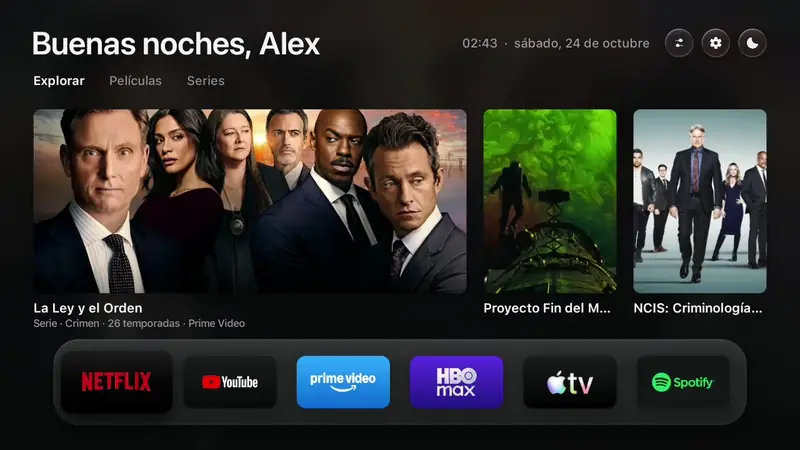
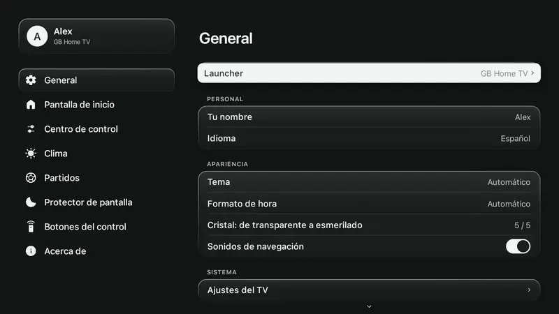
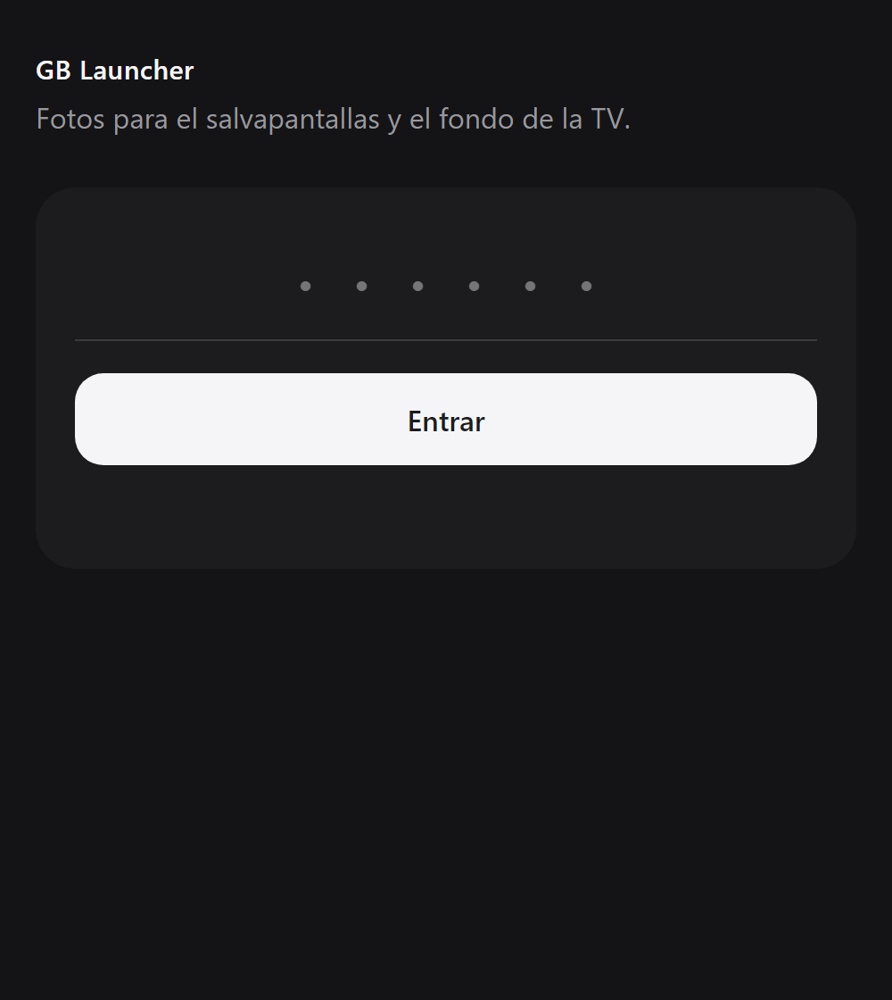

<div align="center">

<picture>
  <source media="(prefers-color-scheme: dark)" srcset="docs/assets/logo-white.png">
  
</picture>

# GB Home TV

**Una pantalla de inicio más rápida y sin anuncios para tu Google TV o Android TV.**<br>
Se configura sola con los ajustes de tu propia TV, y un clic devuelve la antigua.

[English](README.md) · [Português](README.pt.md) · Español

[Por qué](#por-qué-gb-home-tv) · [Instalar](#instalar-en-5-minutos) · [Cómo se usa](#cómo-se-usa) · [Qué incluye](#qué-incluye) · [Capturas](#capturas) · [Preguntas](#preguntas) · [Créditos](#créditos)


</div>

## ¿Por qué GB Home TV?

- **Sin anuncios.** Nada de filas patrocinadas, banners ni vídeos que arrancan solos.
- **Abre más rápido.** En una TV real mostró la pantalla de inicio en 154 ms; la original tardó 217 ms ([los números](#medido-en-una-tv-real)).
- **Nada que configurar.** Se abre en el idioma de tu TV, sigue su claro y oscuro, usa sus unidades y su reloj y adivina tu ciudad por la zona horaria. Después puedes cambiarlo todo.
- **A tu manera.** Elige tus apps, tus equipos, lo que muestra el Centro de control, incluso qué abre cada botón del mando, en cualquier TV.
- **Seguro.** No toca el sistema y no desinstala nada. Un clic vuelve a la pantalla de inicio original, y si falla tres veces seguidas, vuelve sola.
- **Gratis y de código abierto.** Sin cuenta, sin suscripción.

## Instalar en 5 minutos

Necesitas tu TV (Google TV o Android TV, Android 8 o más nuevo) y un ordenador en la misma Wi-Fi. La TV y el ordenador se quedan encendidos.

### La forma fácil y más rápida: que lo haga una IA (recomendado)

Un asistente de código con IA ([Claude Code](https://claude.com/claude-code), Codex, Antigravity...) hace todos los pasos técnicos por ti. Tú solo pulsas unos botones en la TV.

**1. En la TV: activa el modo desarrollador** (es un menú, sin riesgo)
- Abre *Ajustes → Sistema → Acerca de* y pulsa *Compilación de Android TV OS* (o *Número de compilación*) **7 veces**.
- Vuelve a *Ajustes → Sistema → Opciones de desarrollador* y activa la **Depuración USB** (algunas TV la llaman *Depuración de red*).
- Mira la dirección de la TV en *Ajustes → Red e Internet* y anótala. Se parece a `192.168.1.50`.

**2. En el ordenador: pídeselo a la IA.** Abre tu asistente y pega esto, con la dirección de tu TV:

> Instala GB Home TV (github.com/gabrielbaumgratz/LauncherGB) en mi TV en 192.168.1.50.

Descarga el proyecto, instala lo que necesita, compila la app y la pone en tu TV. Preguntará antes de cualquier cosa importante.

**3. En la TV: di que sí.** Un mensaje pregunta *¿Permitir la depuración USB?*. Marca *Permitir siempre* y pulsa OK. Luego abre **GB Home TV** en tus apps y elige *Launcher → GB Home TV*. Listo: pulsa Inicio y ahí está.

<details>
<summary><b>¿Prefieres hacerlo tú? Los pasos a mano</b></summary>

1. **En la TV**, haz el paso 1 de arriba.
2. **Herramientas:** un JDK 17+, las herramientas de línea de comandos del Android SDK (build-tools 34, plataforma android-34) y adb.
   ```bash
   brew install --cask temurin android-commandlinetools android-platform-tools   # macOS
   sdkmanager "build-tools;34.0.0" "platforms;android-34"
   ```
   En Linux usa OpenJDK 17 y las herramientas de línea de comandos de Android; en Windows usa Git Bash o WSL.
3. **Compila:**
   ```bash
   ./build.sh
   ```
   La primera vez crea `config.properties`; editarlo es opcional (mira [la clave de TMDB](#la-clave-de-tmdb)). El resultado es `GBHomeTV.apk`.
4. **Instala:**
   ```bash
   adb connect 192.168.1.50:5555
   adb install -r GBHomeTV.apk
   ```
   En TV TCL, permite también que se ejecute en segundo plano (TCL lo bloquea por defecto y el cambio nunca empieza):
   ```bash
   adb shell "appops set io.freemytv AUTO_START allow || appops set io.freemytv APP_AUTO_START allow"
   ```
5. **En la TV**, abre *GB Home TV* → *Launcher* → *GB Home TV* y acepta *¿Permitir la depuración USB?* una vez más.

Las actualizaciones deben firmarse con la misma clave: guarda `freemytv.keystore`.
</details>

## Cómo se usa

- **Inicio:** tus apps en el estante de cristal y tres pestañas de recomendaciones (Explorar, Películas, Series).
- **Abajo:** el cajón: entradas HDMI, accesos directos, el clima y el widget de partidos.
- **El botón de información (i) del mando, o el primer botón redondo de arriba:** el Centro de control: auriculares Bluetooth, volumen, tema, modo de imagen, AirPlay.
- **El engranaje de arriba:** Ajustes. Elige *Launcher → Original* cuando quieras para volver a la pantalla de inicio de tu TV.
- **En reposo:** el salvapantallas, con tus fotos.

## Qué incluye

- **Un Centro de control** donde eliges qué bloques aparecen.
- **Un widget de partidos** junto al clima: tus equipos y campeonatos (fútbol, baloncesto, NFL, béisbol, hockey, tenis), cada uno con el símbolo de su deporte. Datos de ESPN, sin clave.
- **Un salvapantallas que se lee desde el sofá:** fotos a pantalla completa con acabado mate, un reloj esmerilado, la fecha y el clima. Fotos en orden o al azar, y puede atenuarse para una habitación a oscuras.
- **Fotos desde el móvil:** escanea el código QR de la TV (en un ordenador, escribe la dirección y el PIN) y envía fotos. Solo en la red local.
- **Recomendaciones de tus apps:** títulos en tendencia de las apps de streaming que tienes (con una [clave de TMDB](#la-clave-de-tmdb) gratuita; lo demás funciona sin ella).
- **Ajustes al estilo del iPad,** con el aspecto de la propia pantalla de inicio.
- **Dispositivos Bluetooth:** elige cuáles aparecen, cámbiales el nombre u olvídalos.
- **Tu nombre:** "Buenos días, Ana" (o sin nombre).
- **Botones del mando:** en TCL, Sony, Vestel, KTC y Formovie los botones de apps ya se conocen; en **cualquier** TV puedes enseñarle un botón (*Ajustes → Botones del mando → Añadir un botón*): púlsalo y elige la app que abre.
- **Español, inglés y portugués,** siguiendo a la TV salvo que elijas.

## Capturas

| | |
|---|---|
| Inicio |  |
| Cajón |  |
| Centro de control |  |
| Ajustes |  |
| Partidos |  |
| Salvapantallas |  |
| Botones del mando |  |
| Fotos desde el móvil |  |

### En movimiento

| Una pulsación abajo: entradas, clima, partidos | El Centro de control | Ajustes |
|---|---|---|
|  |  |  |

El salvapantallas:  · [vídeo](docs/assets/es/screensaver.mp4)

La página en el móvil: 

## Medido en una TV real

*Ajustes → Acerca de* mide las dos pantallas de inicio en tu propia TV y las muestra una al lado de la otra. Estos son los números que mostró en una TCL 32S5K (Google TV, Android 14), sin redondear a favor de GB Home TV:

| | Pantalla de inicio original | GB Home TV |
|---|---|---|
| Tiempo del botón Inicio hasta mostrar la pantalla de inicio | 217 ms | 154 ms |
| Memoria libre en la TV | 289 MB | 165 MB |
| Memoria que usa la pantalla de inicio | 89 MB | 152 MB |

GB Home TV abre más rápido y no tiene anuncios, pero lo dibuja todo él mismo y guarda las imágenes en memoria, así que usa **más** memoria que la pantalla de inicio de fábrica. Tus números serán otros.

## Más sobre…

### La clave de TMDB

Solo para las recomendaciones, gratuita, dos minutos: crea una cuenta en [themoviedb.org](https://www.themoviedb.org/signup), abre [Settings → API](https://www.themoviedb.org/settings/api) y pide una clave de desarrollador. Pégala después de `tmdb_key=` en `config.properties` y compila de nuevo. Es tuya: ese archivo no entra en git.

### Fotos desde el móvil

*Ajustes → Salvapantallas → Fotos desde tu móvil.* La TV muestra un código QR y, debajo, la dirección y un PIN. Escanea el código con el móvil (misma Wi-Fi) y elige las fotos; el PIN ya va dentro. En un ordenador, que no tiene cámara, abre la dirección y escribe el PIN. Las fotos se enderezan y se guardan de nuevo para la TV, sin sus datos de GPS. El servidor solo funciona mientras esa pantalla está abierta, y el PIN se bloquea tras unos intentos fallidos.

### AirPlay

GB Home TV no incluye un receptor de AirPlay. Funciona con uno gratuito, **[android-airplay-server](https://github.com/jqssun/android-airplay-server)**, de [jqssun](https://github.com/jqssun) (GPL-3.0): duplicación de pantalla, vídeo y audio. Instala su APK desde la [página de versiones](https://github.com/jqssun/android-airplay-server/releases) (`adb install -r android-airplay-server.apk`). Entonces aparece un botón **AirPlay** en el Centro de control que abre el receptor; en un iPhone, iPad o Mac, elige la TV en el menú de AirPlay.

## Preguntas

**¿Va a estropear mi TV?** No. Es una app normal y un launcher; no toca el sistema. En algunas TV apaga las apps de publicidad del fabricante (nunca las desinstala), y *Launcher → Original* las vuelve a encender.

**¿Cómo vuelvo atrás?** *Ajustes → General → Launcher → Original.* Si GB Home TV falla tres veces seguidas, lo hace solo.

**¿Qué TV?** Probado en una TCL 32S5K (Google TV, Android 14). Debería funcionar en cualquier Android TV o Google TV desde Android 8, como Sony Bravia, Chromecast con Google TV, Xiaomi Mi Box, Philips, onn. y NVIDIA Shield. Las TV LG y Samsung no usan Android: usa un streamer Google TV por HDMI.

**¿Recoge algún dato?** No. Las únicas llamadas de red son el clima (Open-Meteo), las recomendaciones (TMDB, si pones una clave) y los partidos (ESPN).

**Algo no va bien.** Abre una [issue](https://github.com/gabrielbaumgratz/LauncherGB/issues) con el modelo de tu TV y lo que viste.

## Compílalo tú

Sin Gradle, sin librerías: solo el Android SDK.

```bash
export ANDROID_HOME="/ruta/al/android/sdk"
./build.sh            # GBHomeTV.apk
tools/check.sh        # la compilación y los catálogos de traducción
```

Los textos están en `app/assets/i18n/<idioma>.json`; `python3 tools/translate.py` lista lo que le falta a un idioma.

## Créditos

Creado por [Gabriel Baumgratz](https://github.com/gabrielbaumgratz), inspirado en [Free My TV](https://github.com/simbasjungles/free-my-tv).

- **[Free My TV](https://github.com/simbasjungles/free-my-tv)**, de sus colaboradores (MIT): GB Home TV nació de él. La compilación sin Gradle, la pantalla de inicio dibujada en canvas, el cambio a y desde el launcher original y el vigilante son suyos.
- **[android-airplay-server](https://github.com/jqssun/android-airplay-server)**, de jqssun (GPL-3.0): el receptor de AirPlay que abre.
- **SF Pro**, de Apple: la tipografía. Los archivos vienen del repositorio de código abierto [sahibjotsaggu/San-Francisco-Pro-Fonts](https://github.com/sahibjotsaggu/San-Francisco-Pro-Fonts); los términos de licencia de Apple para la fuente siguen vigentes.
- **[Material Symbols](https://fonts.google.com/icons)** (Apache 2.0): los iconos.
- **[TMDB](https://www.themoviedb.org)**: las recomendaciones. Este producto usa la API de TMDB, pero TMDB no lo respalda ni lo certifica.
- **[Open-Meteo](https://open-meteo.com)**: el clima, sin clave. Datos públicos de **ESPN**: los partidos.

## Licencia

[MIT](LICENSE).
