<div align="center">

<picture>
  <source media="(prefers-color-scheme: dark)" srcset="docs/assets/logo-white.png">
  
</picture>

# GB Home TV

**Una pantalla de inicio inspirada en Apple TV para Google TV y Android TV: más rápida, ligera y sin anuncios ni spyware.**<br>
Pestañas de películas, series y deportes, Centro de control y salvapantallas con fotos en lugar de la pantalla de inicio de fábrica. Un clic apaga anuncios y rastreadores, y otro lo devuelve todo.

[English](README.md) · [Português](README.pt.md) · Español

[Ventajas](#ventajas) · [Funcionalidades](#funcionalidades) · [Instalación](#instalación) · [Qué apaga](#qué-apaga) · [Memoria y rendimiento](#memoria-y-rendimiento) · [Cómo se usa](#cómo-se-usa) · [Depois de instalar](#después-de-instalar) · [Preguntas frecuentes](#preguntas-frecuentes)

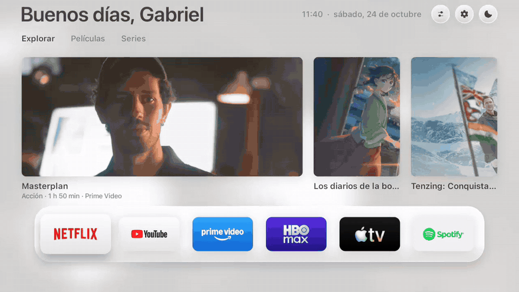

</div>

## Ventajas

| | |
|---|---|
| **Sin anuncios** | Elimina filas patrocinadas, banners invasivos y vídeos promocionales con reproducción automática en la pantalla de inicio de tu TV. |
| **Bloqueo de spyware y telemetría** | Desactiva servicios de seguimiento publicitario, reconocimiento automático de contenido (ACR) y recopilación analítica en segundo plano de los fabricantes. |
| **Más rápida y fluida** | Solo 154 ms para mostrar la pantalla de inicio (frente a 217 ms del launcher de fábrica). Renderizado directo en GPU a 60 cuadros por segundo. |
| **Más memoria RAM libre** | Apaga aplicaciones pesadas y servicios residentes de fábrica que consumen memoria en segundo plano, liberando recursos esenciales en televisores de 1 GB y 1.5 GB. |
| **Privacidad garantizada** | Sin necesidad de cuentas, registros ni inicios de sesión. No recopila ni envía información personal a servidores externos. |
| **Totalmente reversible y segura** | No desinstala nada del sistema operativo. Un clic en *Launcher → Original* restaura todo al estado de fábrica, y el vigilante automático regresa a la pantalla original si detecta fallos. |
| **Gratuita y de código abierto** | Sin costes ocultos, muros de pago ni suscripciones. |

## Funcionalidades

| Característica | Descripción |
|---|---|
| **Centro de control** | Panel lateral instantáneo para alternar salidas de audio Bluetooth (auriculares y barras de sonido), volumen, modo de imagen (en televisores compatibles), tema visual y acceso directo al receptor AirPlay. |
| **Deportes, equipos y deportistas** | Sigue a tus clubes (fútbol, baloncesto, fútbol americano) en ligas y copas (Champions League, Copa Libertadores, ligas locales), además de deportistas individuales (tenistas en rankings ATP/WTA, pilotos de Fórmula 1, luchadores de UFC y golfistas de la PGA). Información pública en tiempo real de ESPN sin necesidad de cuenta. Elige si la pestaña Deportes va primero o última en *Ajustes → Pantalla de inicio → Orden de las pestañas*. |
| **Protector de pantalla personalizado** | Galería fotográfica a pantalla completa con reloj, fecha y clima local. Cinco niveles de brillo adaptados (incluyendo opciones mate y ultra-oscura para dormitorios y paneles OLED). |
| **Envío de fotos desde el móvil** | Transfiere fotografías de tu teléfono al televisor por Wi-Fi local mediante código QR, protegido con servidor temporal y validación por PIN. |
| **Mapeo de botones del mando** | Asigna cualquier botón del mando a distancia para abrir una app específica, desplegar el Centro de control o entrar a los ajustes del televisor. Reconocimiento nativo de teclas de acceso rápido en mandos TCL, Sony, Vestel, KTC y Formovie. |
| **Destacados de tus plataformas** | Catálogo con títulos en tendencia exclusivamente de los servicios de streaming que tienes instalados en el televisor (a través de la API gratuita de TMDB). |
| **Temas adaptativos** | Modos claro, oscuro o sincronización automática con la puesta y salida del sol según tu ubicación. |
| **Modo Rendimiento** | Perfil de configuración optimizado para minimizar el consumo de recursos en hardware modesto. |
| **Compatibilidad multilingüe** | Interfaz adaptada íntegramente al español, portugués e inglés. |

## Qué apaga

**Por qué desactivar:** Los televisores actuales salen de fábrica saturados de software residente que ejecuta tareas continuas en segundo plano: monitorización de lo que reproduces para publicidad dirigida (ACR), canales comerciales de demostración, diagnósticos y telemetría de fabricantes. Esto agota la memoria RAM disponible, congestiona la red local y ralentiza la navegación.

Al activar GB Home TV, el sistema **desactiva de forma segura** (sin desinstalar archivos del sistema) los paquetes identificados de estas categorías:

| Categoría | Qué se desactiva |
|---|---|
| **Canales con publicidad** | TCL Channel, Mi TV+, Coolita y canales promocionales asociados. |
| **Spyware y telemetría publicitaria** | Anoki ACR (reconocimiento automático de pantalla), servicios de analítica de Xiaomi/TCL y segmentación publicitaria de Android. |
| **Demostraciones de tienda** | Modo escaparate de venta, vídeos comerciales residentes y tutoriales promocionales. |
| **Servicios de diagnóstico y registros** | Recolección en segundo plano de volcados de registros y guías de servicio de fabricantes. |

**Componentes que nunca se modifican:** Imagen, sonido, puertos HDMI, mando a distancia, actualizaciones de firmware y servicios esenciales de Google. La opción *Launcher → Original* restablece el funcionamiento original al instante. Consulta el listado completo y auditado en [`HomeMode.java`](app/src/io/freemytv/HomeMode.java).

## Memoria y rendimiento

En Smart TVs de 1 GB o 1.5 GB de RAM (como múltiples modelos de TCL, Xiaomi y Redmi), cada megabyte cuenta para garantizar fluidez en aplicaciones de reproducción de vídeo:

1. **Desactivación de bloatware:** El apagado de servicios de rastreo y canales comerciales libera ciclos del procesador y memoria en segundo plano.
2. **Modo Rendimiento:** En *Ajustes → Rendimiento → Modo*, puedes activar el perfil *Rendimiento*, que apaga widgets secundarios y animaciones complejas, ahorrando memoria RAM adicional.
3. **Uso eficiente de AirPlay:** Las aplicaciones de recepción AirPlay consumen memoria mientras están en ejecución (~40 MB comprobados). En dispositivos con memoria reducida, cierra el receptor cuando no estés transmitiendo.

Rendimiento transparente: GB Home TV inicia más rápido y ofrece una respuesta táctil inmediata gracias al dibujado directo en la GPU, prescindiendo de motores web pesados. En *Ajustes → Acerca de* puedes comprobar el consumo exacto y los tiempos medidos en tu propio televisor.

## Capturas

| | |
|---|---|
| **Inicio** | 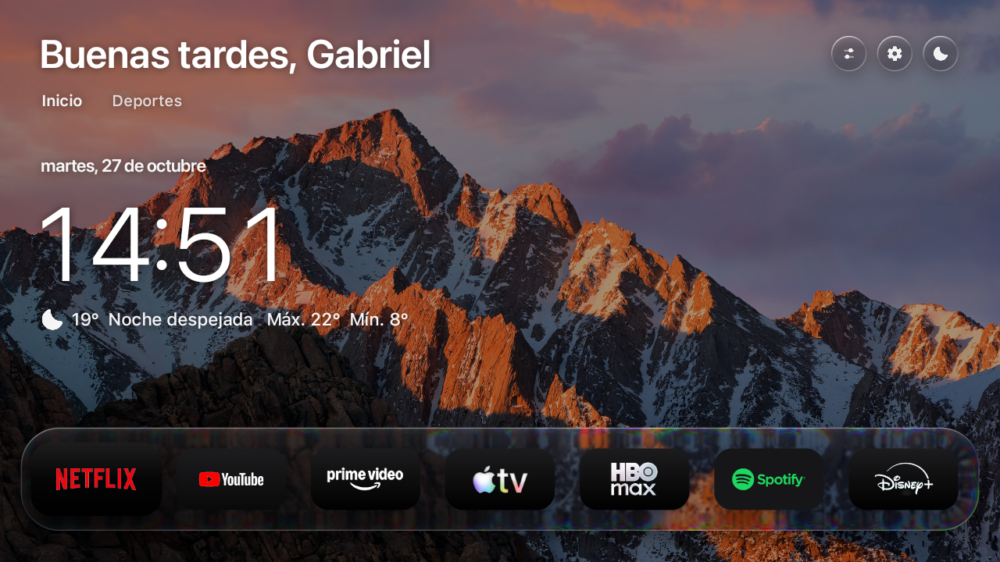 |
| **Cajón** | 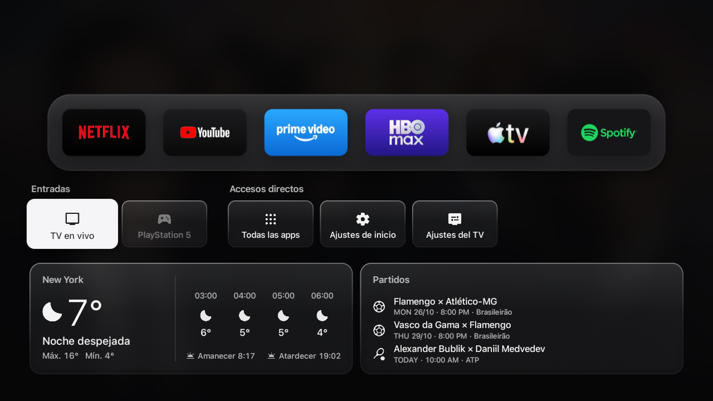 |
| **Centro de control** | 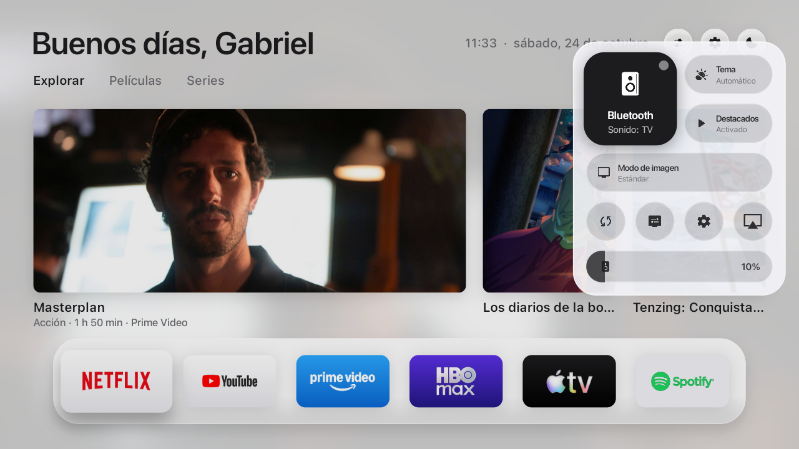 |
| **Ajustes** | 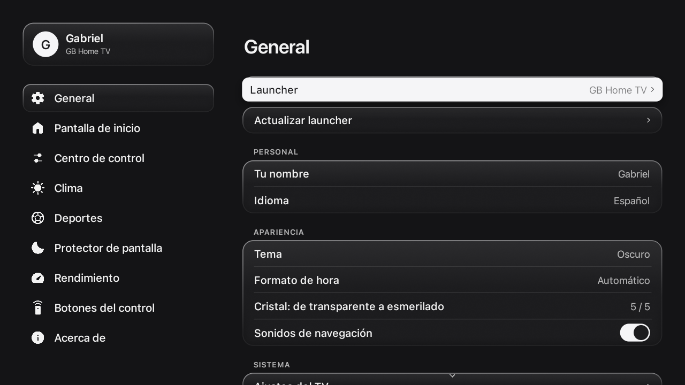 |
| **Pestaña Deportes** | 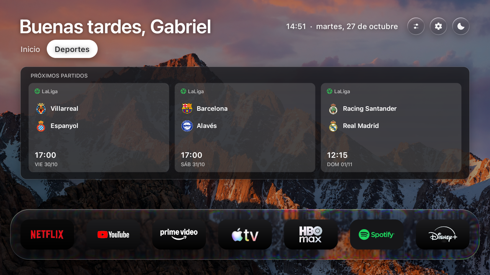 |
| **Ajustes de deportes** | 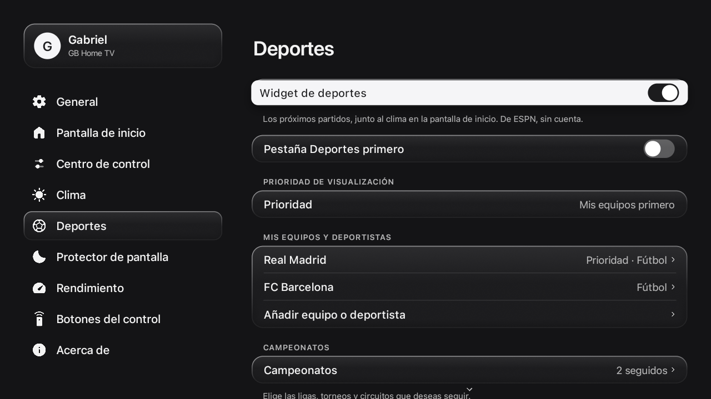 |
| **Protector de pantalla** | 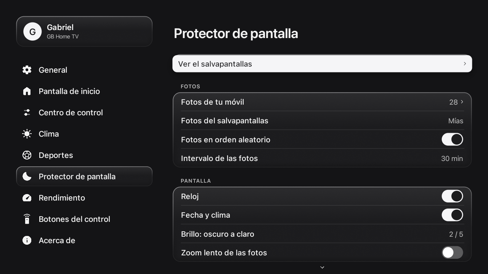 |
| **Rendimiento** | 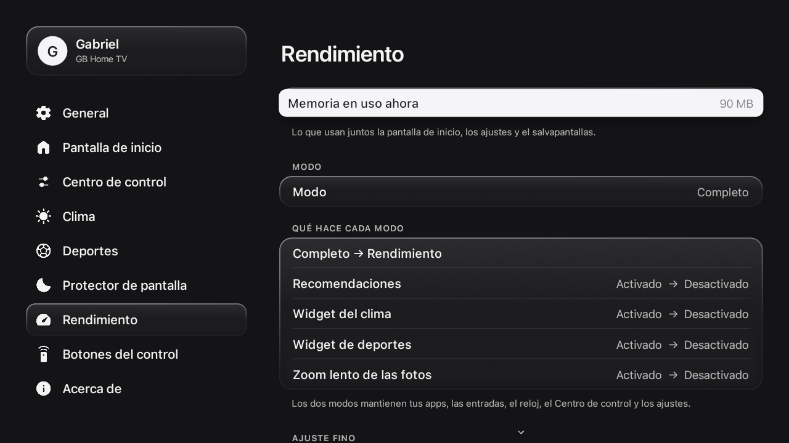 |
| **Botones del control** | 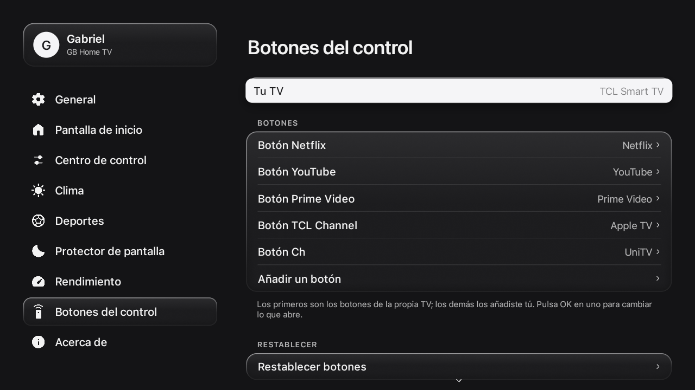 |
| **Fotos desde el celular** | 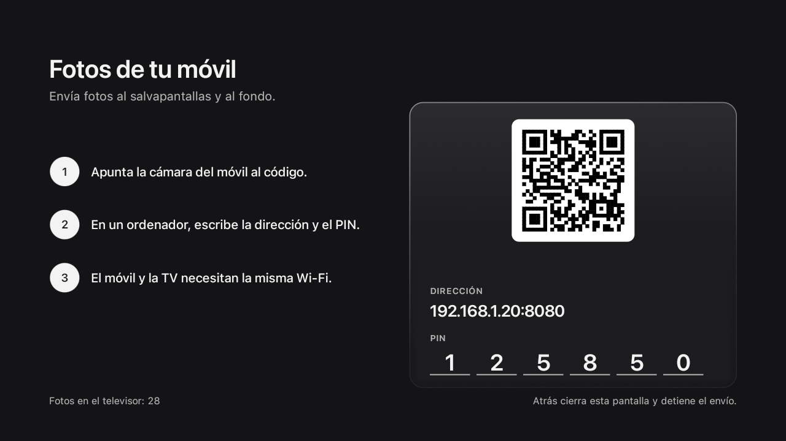 |

En movimiento: [Centro de control](docs/assets/es/control-center.webp) · [Ajustes](docs/assets/es/settings.webp) · [Protector de pantalla](docs/assets/es/screensaver.mp4)

## Instalación

**Requisitos:** Un televisor, TV Box o reproductor con Google TV o Android TV (Android 8 o superior) y un ordenador conectado a la misma red Wi-Fi.

### 1. Preparar la TV

1. Ve a *Ajustes → Sistema → Acerca de*: pulsa **7 veces** consecutivas sobre *Versión de Android TV OS* (o *Número de compilación*) para desbloquear las opciones de desarrollo.
2. En *Ajustes → Sistema → Opciones para desarrolladores*: activa **Depuración USB** (o *Depuración de red*).
3. En *Ajustes → Red e Internet* → selecciona tu red Wi-Fi y anota la **dirección IP** asignada (por ejemplo: `192.168.0.137`).

### 2A. Instalación con asistente de IA (recomendado)

Abre tu asistente de código preferido ([Claude Code](https://claude.com/claude-code), Codex, Antigravity…) e indícale:

> Instala GB Home TV (github.com/gabrielbaumgratz/LauncherGB) en mi TV en 192.168.0.137.

El asistente compilará y transferirá la aplicación. Cuando aparezca el aviso *¿Permitir depuración USB?* en tu televisor, selecciona *Permitir siempre* y confirma.

### 2B. Instalación manual

```bash
# Requisitos: JDK 17+, Android SDK (build-tools 34, android-34) y adb
./build.sh                                 # genera GBHomeTV.apk firmado
adb connect 192.168.0.137:5555             # introduce la IP de tu televisor
adb install -r GBHomeTV.apk
```

- **Televisores TCL:** ejecuta adicionalmente `adb shell "appops set io.freemytv AUTO_START allow || appops set io.freemytv APP_AUTO_START allow"`.
- **macOS / Linux:** instala dependencias mediante tu gestor (`brew install --cask temurin android-commandlinetools android-platform-tools`). **Windows:** utiliza Git Bash o WSL.
- Conserva el archivo `freemytv.keystore`: futuras actualizaciones requieren la misma clave criptográfica.

### 3. Activación en el televisor

Abre **GB Home TV → General → Launcher → GB Home TV** y confirma el permiso de depuración local si se solicita. Al presionar el botón Inicio (Home) de tu mando, se abrirá la nueva interfaz.

## Después de instalar

Ajustes opcionales para personalizar tu experiencia:

### Catálogo de streaming (TMDB)

Muestra los títulos en tendencia disponibles en las plataformas que utilizas:

1. Crea una cuenta gratuita en [themoviedb.org](https://www.themoviedb.org/signup) y confirma tu correo.
2. Accede a tu perfil → *Ajustes* → *API* → solicita una clave de tipo **Developer** (propósito: "uso personal en pantalla de inicio de TV").
3. Copia el **API Read Access Token**.
4. En el archivo `config.properties` (creado en la primera ejecución de `./build.sh`), pega el valor tras `tmdb_key=`, sin comillas ni espacios.
5. Recompila e instala la actualización (`./build.sh` e `adb install -r GBHomeTV.apk`).

<details>
<summary>Opciones adicionales de <code>config.properties</code></summary>

| Parámetro | Función | Valor por defecto |
|---|---|---|
| `tmdb_region` | Código de país (dos letras, ej: ES, MX, AR) | Región del televisor |
| `latitude`, `longitude`, `city` | Coordenadas y ciudad para pronóstico meteorológico y horario solar | Calculado por zona horaria |
| `language` | Idioma de interfaz (`auto`, `es`, `en`, `pt`) | `auto` |
| `temperature` | Unidad de temperatura (`C`, `F` o `auto`) | `auto` |

</details>

### Compatibilidad con AirPlay

GB Home TV integra el acceso directo desde el Centro de control; la recepción del flujo multimedia la realiza el software de código abierto [android-airplay-server](https://github.com/jqssun/android-airplay-server) (jqssun, GPL-3.0):

1. Descarga el paquete `.apk` desde el apartado [Releases](https://github.com/jqssun/android-airplay-server/releases).
2. Instálalo mediante adb: `adb install -r archivo.apk`.
3. El botón **AirPlay** estará disponible en el Centro de control. Desde tu iPhone, iPad o Mac, selecciona el televisor en el menú AirPlay.

### Envío de fotos desde el móvil

Accede a *Ajustes → Protector de pantalla → Fotos de tu celular*. Escanea el código QR en pantalla con la cámara de tu teléfono (o accede a la dirección local con el PIN desde un ordenador) para enviar fotos directamente al almacenamiento privado del televisor.

## Cómo se usa

| Botón / Acción | Función |
|---|---|
| **Botón Inicio (Home)** | Pantalla principal con la repisa de aplicaciones y pestañas de destacados. |
| **Cruceta Abajo** | Cajón inferior con accesos a puertos HDMI, ajustes, clima y deportes. |
| **Botón circular superior** | Acceso instantáneo al Centro de control (Bluetooth, volumen, imagen, tema y AirPlay). |
| **Icono de engranaje** | Menú completo de configuración y personalización del sistema. |
| **Inactividad** | Protector de pantalla ambiental con fotografías personales, reloj y clima. |

## Preguntas frecuentes

**¿Puede dañar mi televisor?** No. GB Home TV funciona como una aplicación convencional en el espacio de usuario de Android. No modifica particiones de sistema, no reemplaza el firmware ni borra ningún archivo esencial del dispositivo.

**¿Cómo regreso al launcher de fábrica?** Dirígete a *Ajustes → General → Launcher → Original*. Todos los servicios del fabricante que estaban desactivados volverán a funcionar inmediatamente.

**¿Qué dispositivos son compatibles?** Cualquier televisor, TV Box o reproductor con Google TV o Android TV (versión 8 en adelante): TCL, Sony, Xiaomi, Philips y otros smart TV, además de cajas y sticks como Mi Box, onn., Chromecast con Google TV y NVIDIA Shield. Los televisores de marcas como LG (webOS) o Samsung (Tizen) no utilizan Android; en ellos se aconseja conectar un reproductor Google TV por HDMI.

**¿El software recopila datos de los usuarios?** En absoluto. Las únicas conexiones de red que realiza corresponden exclusivamente a los servicios que decidas habilitar: pronóstico meteorológico (Open-Meteo), recomendaciones de streaming (TMDB, utilizando tu propia clave) e información deportiva pública (ESPN).

## Compilación

Construido íntegramente sin dependencias pesadas ni Gradle, utilizando únicamente el Android SDK:

```bash
export ANDROID_HOME="/ruta/al/android/sdk"
./build.sh            # genera el paquete GBHomeTV.apk firmado
tools/check.sh        # comprueba integridad de código y catálogos de traducción
```

## Créditos

Creado y mantenido por [Gabriel Baumgratz](https://github.com/gabrielbaumgratz), basado originalmente en el proyecto [Free My TV](https://github.com/simbasjungles/free-my-tv).

- **[Free My TV](https://github.com/simbasjungles/free-my-tv)** (MIT): base original sobre la cual evolucionó este launcher.
- **Apple TV (tvOS)**: inspiración visual de la pantalla de inicio, las pestañas y el Centro de control. GB Home TV es un proyecto independiente, sin vínculo ni aval de Apple.
- **[android-airplay-server](https://github.com/jqssun/android-airplay-server)**, por jqssun (GPL-3.0): receptor auxiliar para AirPlay.
- **[Material Symbols](https://fonts.google.com/icons)** (Apache 2.0): iconografía del sistema.
- **[TMDB](https://www.themoviedb.org)**: metadatos y recomendaciones de streaming.
- **[Open-Meteo](https://open-meteo.com)**: información meteorológica. **ESPN**: marcadores y calendarios deportivos públicos.

## Licencia

[MIT](LICENSE).
