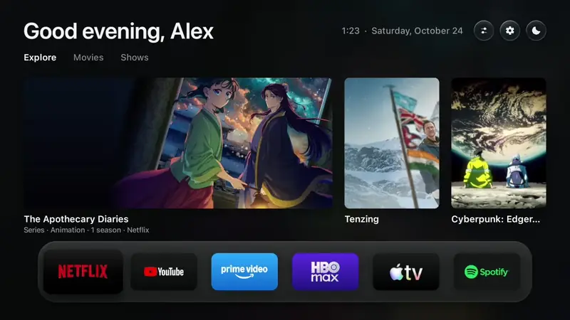

<div align="center">

<picture>
  <source media="(prefers-color-scheme: dark)" srcset="docs/assets/logo-white.png">
  
</picture>

# GB Launcher

**A fast, ad-free home screen for Google TV and Android TV, with a look that borrows from tvOS.**

Open source, made for anyone to use. Created by [Gabriel Baumgratz](https://github.com/gabrielbaumgratz), inspired by [Free My TV](https://github.com/simbasjungles/free-my-tv).<br>
No ads, a Control Center, your photos on the screensaver, a games widget. One button to undo.

English · [Português](README.pt.md)

[What you get](#what-you-get) · [Screenshots](#screenshots) · [Measured](#measured-on-a-real-tv) · [Install](#install) · [AirPlay](#airplay) · [Settings](#settings) · [Build](#build-it-yourself) · [Credits](#credits)


</div>

## What you get

- **No ads.** No sponsored rows, banners or autoplaying promos.
- **Your apps in front.** A glass shelf with the apps you choose, in the order you choose, edited on the TV.
- **Trending picks from the apps you have.** Three tabs (Explore, Movies, Shows), fed by TMDB with your own free key. Without a key everything else still works.
- **A Control Center.** Press the info button on the remote (or the first round button at the top): Bluetooth headphones in one click, volume, light and dark theme, picture mode and AirPlay. You choose which tiles it shows.
- **A drawer one press down.** HDMI inputs with a live signal marker, shortcuts, the weather with an hourly outlook, and the games widget.
- **A games widget.** Pick your teams and the championships you follow (soccer, basketball, NFL, baseball, hockey, tennis) and the next games sit beside the forecast, each with its sport's symbol. The data comes from ESPN, with no key.
- **A screensaver you can read from the couch.** Full-screen photos in a matte finish, a frosted translucent clock at the top left, the date and the weather at the top right. Photos in order or shuffled, and a choice of how much it dims for a dark room.
- **Photos from your phone.** Scan the QR code on the TV (or, on a computer, type the address and the PIN) and send photos for the screensaver and the background. Local network only.
- **Settings laid out like the iPad's.** Categories in a sidebar, grouped cards on the right. The cards, the focus and the colors are the home screen's own: black or white by the theme.
- **Bluetooth devices.** Choose which headphones show up on the home screen, give them a name of your own, or forget them for good.
- **Your name.** "Good morning, Ana": type the name you want in Settings, or leave it empty.
- **Remote buttons that open what you want.** Netflix, YouTube, Prime Video and the brand buttons (TCL, Sony, Vestel, KTC, Formovie) can open any installed app.
- **English, Portuguese and Spanish.** Picked in Settings or taken from the TV.
- **Safe.** No root. Nothing is uninstalled. *Launcher → Original* brings the factory home screen back, and a watchdog does it by itself after repeated crashes.

## Screenshots

| | English | Português |
|---|---|---|
| Home |  |  |
| Drawer |  |  |
| Control Center |  |  |
| Settings |  |  |
| Games |  |  |
| Screensaver |  |  |
| Remote buttons |  |  |
| Photos from your phone |  |  |

### In motion

| One press down: the inputs, the weather, the games | The Control Center | Settings |
|---|---|---|
|  |  |  |

The screensaver:  · [video](docs/assets/en/screensaver.mp4) · [em português](docs/assets/pt/screensaver.mp4)

The page on your phone: 

## Measured on a real TV

The About page of the app measures both home screens on your own TV and shows them side by side. These are the numbers it showed on a TCL 32S5K (Google TV, Android 14), with nothing rounded in GB Launcher's favor:

| | Original home screen | GB Launcher |
|---|---|---|
| Time for the Home button to show the home screen | 217 ms | 154 ms |
| Free memory on the TV | 289 MB | 165 MB |
| Memory used by the home screen | 89 MB | 152 MB |

GB Launcher opens faster and has no ads, but it draws everything itself and keeps its images in memory, so it uses **more** memory than the stock home screen. Your numbers will differ: open *Settings → About* after switching.

## Install

You need a Google TV or Android TV (Android 8 or newer) and a computer on the same Wi-Fi. About ten minutes.

### With an AI assistant

1. **On the TV**, turn on developer mode: Settings → System → About → press *Android TV OS build* 7 times. Then Settings → System → Developer options → turn on **USB debugging** (or network debugging). Write down the TV's IP address (Settings → Network & Internet).
2. **On your computer**, open an AI coding assistant ([Claude Code](https://claude.com/claude-code), Codex or Antigravity) and say:
   > Install GB Launcher (github.com/gabrielbaumgratz/LauncherGB) on my TV at 192.168.1.50. I live in Lisbon.
3. **On the TV**, open *GB Launcher* → *Launcher* → *GB Launcher*. The TV asks *Allow USB debugging?*: tick *Always allow* and accept.

### By hand

1. **On the TV**, do step 1 above.
2. **Tools:** a JDK 17+, the Android SDK command-line tools (build-tools 34, platform android-34) and adb.
   ```bash
   brew install --cask temurin android-commandlinetools android-platform-tools   # macOS
   sdkmanager "build-tools;34.0.0" "platforms;android-34"
   ```
   On Linux use OpenJDK 17 and Android's command-line tools; on Windows use Git Bash or WSL.
3. **Build:**
   ```bash
   ./build.sh
   ```
   The first run creates `config.properties`. Fill in your city and, optionally, your [TMDB key](#the-tmdb-key), then run it again. The result is `GBLauncher.apk`.
4. **Install:**
   ```bash
   adb connect 192.168.1.50:5555
   adb install -r GBLauncher.apk
   ```
   On TCL TVs, also let it run in the background (TCL blocks it by default, and the switch never starts):
   ```bash
   adb shell "appops set io.freemytv AUTO_START allow || appops set io.freemytv APP_AUTO_START allow"
   ```
5. **On the TV**, open *GB Launcher* → *Launcher* → *GB Launcher*, and accept *Allow USB debugging?* once more (this time for GB Launcher itself).

Updates must be signed with the same key: keep `freemytv.keystore`.

**Tested on:** TCL 32S5K (Google TV, Android 14). It should run on any Android TV or Google TV from Android 8 on, such as Sony Bravia, Chromecast with Google TV, Xiaomi Mi Box, Philips, onn. and NVIDIA Shield.

## AirPlay

GB Launcher doesn't ship an AirPlay receiver. It works with a free one, **[android-airplay-server](https://github.com/jqssun/android-airplay-server)** by [jqssun](https://github.com/jqssun): the first open-source AirPlay receiver for Android, with screen mirroring, video and audio (GPL-3.0). Install its APK from the [releases page](https://github.com/jqssun/android-airplay-server/releases):

```bash
adb install -r android-airplay-server.apk
```

Once it's on the TV, an **AirPlay** button shows up in the Control Center and opens the receiver. Then, on an iPhone, iPad or Mac, pick the TV in the AirPlay menu.

## Settings

Everything is on the TV, in *GB Launcher* (the gear at the top, or the app's icon). The first values come from `config.properties`.

| Category | What's in it |
|---|---|
| **General** | Switch between GB Launcher and the original home screen · your name · language · theme (light, dark, automatic) · time format · glass · navigation sounds · the TV's own settings |
| **Home Screen** | The shelf (apps and order) · the round buttons at the top · recommendations on or off · which HDMI inputs show up · Bluetooth headphones: show, rename, forget |
| **Control Center** | Which tiles it shows: Bluetooth, theme, recommendations, picture mode, pair, TV settings, home settings, AirPlay, volume |
| **Weather** | Weather widget on or off · °C, °F or automatic · your city |
| **Games** | Games widget on or off · your teams · the championships to follow, by sport |
| **Screensaver** | Preview · photos from your phone · mine or recommendations · shuffle · photo interval · brightness · clock · date and weather |
| **Remote Buttons** | The app each remote button opens |
| **About** | Version · memory and speed against the original home screen · recommendations status · notices · credits |

| `config.properties` key | What it does | Default |
|---|---|---|
| `tmdb_key` | Your free TMDB key, for the picks | empty |
| `tmdb_region` | Your country (two letters) | `US` |
| `latitude`, `longitude` | Your city, for the weather and the sunset | New York |
| `city` | The name on the weather card | `Weather` |
| `language` | `auto`, `en`, `pt` or `es` | `auto` |
| `temperature` | `C`, `F` or `auto` | `auto` |

### The TMDB key

Free, two minutes: create an account at [themoviedb.org](https://www.themoviedb.org/signup), open [Settings → API](https://www.themoviedb.org/settings/api) and request a developer key. Paste it after `tmdb_key=`. It's yours: `config.properties` stays out of git.

### Photos from your phone

*Settings → Screensaver → Photos from your phone.* The TV shows a QR code, and below it the address and a PIN. On your phone (same Wi-Fi), scan the code and choose photos; the PIN is already in it. On a computer, which has no camera, open the address and type the PIN. Photos are turned upright and saved again for the TV, without their GPS tags. The server runs only while that screen is open, and the PIN locks after a few wrong tries.

### The games widget

*Settings → Games.* Turn it on, add a team (type its name; the search is ESPN's) and tick the championships you want. The widget shows three games: your teams' first, then the rest by date. ESPN's JSON is unofficial and can change; when it does, only `Sports.java` needs a look.

## Build it yourself

No Gradle, no libraries: only the Android SDK.

```bash
export ANDROID_HOME="/path/to/android/sdk"
./build.sh            # GBLauncher.apk
tools/check.sh        # the build and the translation catalogues
```

Texts live in `app/assets/i18n/<lang>.json`; `python3 tools/translate.py` lists what a language lacks.

## Credits

- **[Free My TV](https://github.com/simbasjungles/free-my-tv)**, by its contributors (MIT): GB Launcher grew from it. The Gradle-free build, the canvas-drawn home screen, the switch to and from the original launcher and the watchdog are theirs.
- **[android-airplay-server](https://github.com/jqssun/android-airplay-server)**, by jqssun (GPL-3.0): the AirPlay receiver GB Launcher opens.
- **SF Pro**, by Apple: the typeface. The files come from the open-source repository [sahibjotsaggu/San-Francisco-Pro-Fonts](https://github.com/sahibjotsaggu/San-Francisco-Pro-Fonts); Apple's own license terms for the font still apply.
- **[Material Symbols](https://fonts.google.com/icons)** (Apache 2.0): the icons.
- **[TMDB](https://www.themoviedb.org)**: the picks. This product uses the TMDB API but is not endorsed or certified by TMDB.
- **[Open-Meteo](https://open-meteo.com)**: the weather, with no key. **ESPN**'s public data: the games.

## License

[MIT](LICENSE).
