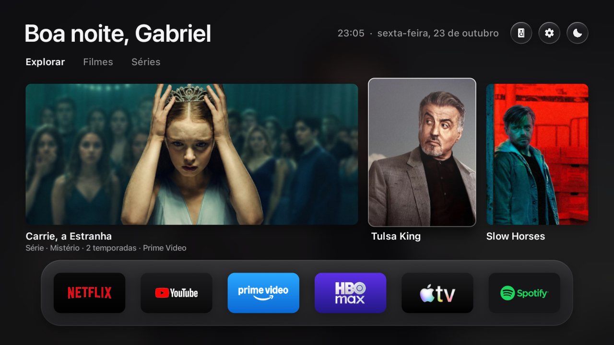
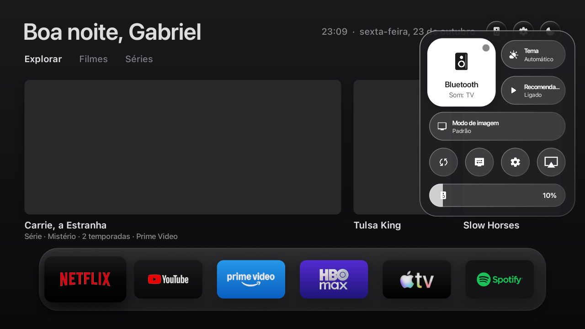
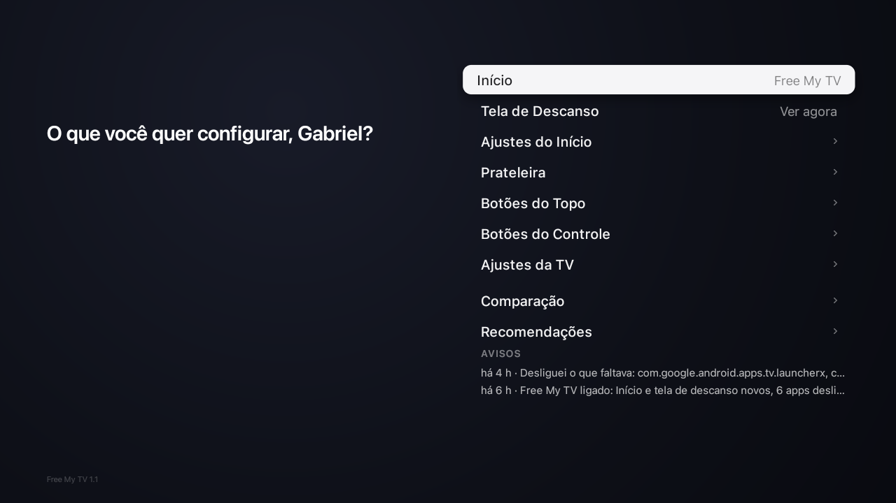

# GB Launcher

> **Launcher minimalista, ultrarrápido, sem anúncios e com estética refinada (inspirada na Apple TV) para Google TV e Android TV.**



O **GB Launcher** substitui a tela inicial padrão cheia de anúncios e lentidão das Smart TVs por uma experiência fluida, limpa e moderna. Construído em Java nativo sem frameworks pesados, ele foi desenvolvido para rodar travado a 60 FPS com baixo consumo de memória.

---

## ✨ Principais Funcionalidades

### 1. 🎛️ Central de Controle Integrada (Side Panel)
- **Controle de Fones Bluetooth em 1 clique:** Conecte ou desconecte fones e caixas de som Bluetooth diretamente pelo painel lateral sem navegar pelas configurações do sistema.
- **Alternância Rápida de Tema:** Alterne entre os modos Escuro, Claro ou Automático (sincronizado com o nascer e pôr do sol).
- **Controles Rápidos:** Sliders de volume integrados e perfis de imagem da TV.
- **Acesso Instantâneo:** Sobrepõe-se com efeito de vidro translúcido sobre a tela inicial ou sobre qualquer aplicativo em execução.

<p align="center">
  
</p>

### 2. 📺 Tipografia e Estética Apple TV
- **San Francisco Pro (SF Pro):** Tipografia oficial com tamanhos ópticos calibrados (*SF Pro Display* para títulos, relógio e datas; *SF Pro Text* para metadados e rótulos).
- **Dígitos Tabulares (`tnum`):** Relógio, temperaturas e cotações com números de largura fixa, eliminando qualquer trepidação ao mudar os dígitos.
- **Shaders de Vidro Translúcido:** Efeitos visuais modernos em shaders AGSL acelerados por hardware.

### 3. 🌤️ Previsão do Tempo e 📈 Mercados em Tempo Real
- **Clima Completo:** Temperatura atual, condição climática, mínimas/máximas do dia e previsão hora a hora.
- **Cotações Financeiras:** Preços e variação percentual 24h de ativos de mercado em tempo real.

### 4. 🎬 Recomendações TMDB
- Filmes e séries recomendados com pôsteres e informações de alta definição via TMDB, sem banners promocionais invasivos.

### 5. 🖼️ Tela de Descanso Dinâmica (Screensaver)
- Efeito *Ken Burns* (pan e zoom suave) alternando fotos em tela cheia com crossfade suave a cada 30 segundos.
- Relógio com efeito de vidro e informações climáticas no canto da tela.
- Servidor local integrado para envio direto de fotos do celular para a TV via Wi-Fi.

### 6. ⚙️ Configurações Customizadas
- Gerenciamento de estante de aplicativos, remapeamento dos botões de streaming do controle remoto e proteção contra falhas (Watchdog).

<p align="center">
  
</p>

---

## 🚀 Como Instalar na sua TV

### Pré-requisitos
- TV ou TV Box com **Google TV** ou **Android TV** (Android 8.0+ / API 26+).
- Computador com **ADB** na mesma rede Wi-Fi da TV.

### Passo a Passo

1. **Ative a Depuração na TV:**
   - Na sua TV: `Configurações` ➔ `Sistema` ➔ `Sobre` ➔ clique 7 vezes sobre `Número da Versão / Build`.
   - Volte para `Sistema` ➔ `Opções do Desenvolvedor` ➔ ative **Depuração USB / Depuração de Rede**.
   - Anote o endereço IP da TV (`Configurações` ➔ `Rede e Internet`).

2. **Conecte e Instale:**
   ```bash
   adb connect <IP_DA_TV>:5555
   adb install -r GBLauncher.apk
   ```

3. **Inicie o GB Launcher:**
   - Abra o **GB Launcher** na lista de aplicativos da sua TV.
   - Siga as instruções na tela para ativá-lo como sua tela inicial padrão (você pode retornar à tela original a qualquer momento em Configurações).

---

## 🛠️ Compilação a partir do Código-Fonte

O projeto utiliza um pipeline de compilação sem Gradle, direto via Android SDK:

```bash
# Definir o caminho do Android SDK
export ANDROID_HOME="/caminho/para/android/sdk"

# Compilar, zip-alinhar e assinar o APK
./build.sh
```

O arquivo `GBLauncher.apk` será gerado na raiz pronto para instalação.

---

## 📄 Licença

Distribuído sob a licença [MIT](LICENSE).
