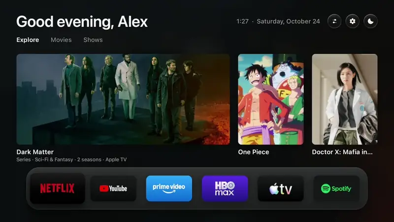
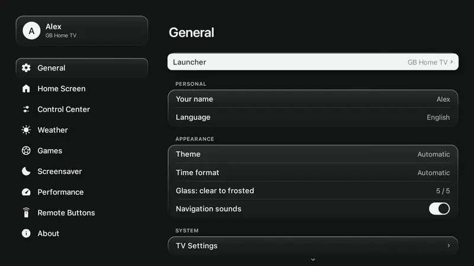

<div align="center">

<picture>
  <source media="(prefers-color-scheme: dark)" srcset="docs/assets/logo-white.png">
  
</picture>

# GB Home TV

**A faster, ad-free home screen for your Google TV or Android TV.**<br>
It sets itself up from your TV's own settings, and one click brings the old one back.

English · [Português](README.pt.md) · [Español](README.es.md)

[Why](#why-gb-home-tv) · [Install](#install-in-5-minutes) · [How to use it](#how-to-use-it) · [What's inside](#whats-inside) · [Screenshots](#screenshots) · [What it turns off](#what-it-turns-off) · [Extras](#optional-extras-step-by-step) · [Questions](#questions) · [Credits](#credits)


</div>

## Why GB Home TV?

- **No ads.** No sponsored rows, no banners, no videos that start on their own.
- **Opens faster.** On a real TV it showed the home screen in 154 ms; the stock one took 217 ms ([the numbers](#measured-on-a-real-tv)).
- **Nothing to set up.** It opens in your TV's language, follows its light or dark time, uses your TV's units and clock, and guesses your city from its time zone. You can change all of it later.
- **Yours to arrange.** Choose your apps, your teams, what the Control Center shows, even what each remote button opens, on any TV.
- **Safe.** It doesn't touch the system and uninstalls nothing. One click goes back to the original home screen, and if it ever crashes three times, it goes back by itself.
- **Free and open source.** No account, no subscription.

## Install in 5 minutes

You need your TV (Google TV or Android TV, Android 8 or newer) and a computer on the same Wi-Fi. The TV and the computer both stay on.

### The easy way, and the fastest: let an AI do it (recommended)

An AI coding assistant ([Claude Code](https://claude.com/claude-code), Codex, Antigravity...) can do all the technical steps for you. You only press a few buttons on the TV.

**1. On the TV: turn on developer mode** (it's a menu, nothing risky)
- Open *Settings → System → About* and press *Android TV OS build* (or *Build number*) **7 times**.
- Go back to *Settings → System → Developer options* and turn on **USB debugging** (some TVs call it *Network debugging*).
- Find the TV's **address (its IP)**: *Settings → Network & Internet*, tap your Wi-Fi and look for *IP address*. It's four numbers with dots, like `192.168.1.50`. **Yours is different: write it down and use it wherever this page says `192.168.1.50`.**

**2. On the computer: ask the AI.** Open your assistant and paste this, **changing the numbers to your TV's address**:

> Install GB Home TV (github.com/gabrielbaumgratz/LauncherGB) on my TV at 192.168.1.50.

It downloads the project, installs what it needs, builds the app and puts it on your TV. It will ask before anything important, and it may take a few minutes the first time.

**3. On the TV: say yes.** A message asks *Allow USB debugging?*. Tick *Always allow* and press OK. Then open **GB Home TV** from your apps and choose *Launcher → GB Home TV*. Done: press Home and it's there.

<details>
<summary><b>Prefer to do it yourself? The steps by hand</b></summary>

1. **On the TV**, do step 1 above.
2. **Tools:** a JDK 17+, the Android SDK command-line tools (build-tools 34, platform android-34) and adb.
   ```bash
   brew install --cask temurin android-commandlinetools android-platform-tools   # macOS
   sdkmanager "build-tools;34.0.0" "platforms;android-34"
   ```
   On Linux use OpenJDK 17 and Android's command-line tools; on Windows use Git Bash or WSL.
3. **Build:**
   ```bash
   ./build.sh
   ```
   The first run creates `config.properties`; editing it is optional (see [the extras](#optional-extras-step-by-step)). The result is `GBHomeTV.apk`.
4. **Install:**
   ```bash
   adb connect 192.168.1.50:5555
   adb install -r GBHomeTV.apk
   ```
   On TCL TVs, also let it run in the background (TCL blocks it by default, and the switch never starts):
   ```bash
   adb shell "appops set io.freemytv AUTO_START allow || appops set io.freemytv APP_AUTO_START allow"
   ```
5. **On the TV**, open *GB Home TV* → *Launcher* → *GB Home TV*, and accept *Allow USB debugging?* once more.

Updates must be signed with the same key: keep `freemytv.keystore`.
</details>

## How to use it

- **Home:** your apps on the glass shelf, and three tabs of picks (Explore, Movies, Shows).
- **Down:** the drawer: HDMI inputs, shortcuts, the weather and the games widget.
- **The info button (i) on the remote, or the first round button at the top:** the Control Center: Bluetooth headphones, volume, theme, picture mode, AirPlay.
- **The gear at the top:** Settings. Pick *Launcher → Original* any time to go back to your TV's own home screen.
- **Idle:** the screensaver, with your photos.

## What's inside

- **A Control Center** where you choose which tiles show.
- **A games widget** beside the weather: your teams and championships (soccer, basketball, NFL, baseball, hockey, tennis), each with its sport's symbol. Data from ESPN, no key.
- **A screensaver you can read from the couch:** matte full-screen photos, a frosted clock, the date and the weather. Photos in order or shuffled, and it can dim for a dark room.
- **Photos from your phone:** scan the QR code on the TV (on a computer, type the address and the PIN) and send photos. Local network only.
- **Picks from your apps:** trending titles from the streaming apps you have (with a free TMDB key, [explained below](#optional-extras-step-by-step); everything else works without one).
- **Settings laid out like the iPad's,** in the home screen's own look.
- **Bluetooth devices:** choose which show up, rename them, forget them.
- **Your name:** "Good morning, Ana" (or no name).
- **Remote buttons:** on TCL, Sony, Vestel, KTC and Formovie the app buttons are known; on **any** TV you can teach it a button (*Settings → Remote Buttons → Add a button*): press it, choose the app it opens.
- **English, Portuguese and Spanish,** following your TV unless you choose.

## Screenshots

| | English | Português |
|---|---|---|
| Home |  |  |
| Drawer |  |  |
| Control Center |  |  |
| Settings |  |  |
| Games |  |  |
| Screensaver |  |  |
| Performance |  |  |
| Remote buttons |  |  |
| Photos from your phone |  |  |

### In motion

| The Control Center | Settings |
|---|---|
|  |  |

The screensaver ([video](docs/assets/en/screensaver.mp4)):


## What it turns off

The promise is a home screen without ads, spyware or telemetry. When you switch to GB Home TV, it turns off (never uninstalls) the maker's promo, demo and tracking apps it knows about, and *Launcher → Original* turns them back on. On TCL, for example: the promo channels and ads (TCL Channel and its Live TV), the account and message boxes, the store demo, the repair-guide and log-collecting apps, and Android's ad targeting. On other brands, the same kind of thing: Anoki ACR (it watches what's on the screen), Xiaomi's analytics, Mi TV+ and Coolita promos, store demos. Picture, sound, inputs, remote, updates and Google's services are protected and never touched. The full list is in [`HomeMode.java`](app/src/io/freemytv/HomeMode.java).

## Measured on a real TV

*Settings → About* measures both home screens on your own TV and shows them side by side. These are the numbers it showed on a TCL 32S5K (Google TV, Android 14), with nothing rounded in GB Home TV's favor:

| | Original home screen | GB Home TV |
|---|---|---|
| Time for the Home button to show the home screen | 217 ms | 154 ms |
| Free memory on the TV | 289 MB | 165 MB |
| Memory used by the home screen | 89 MB | 152 MB |

GB Home TV opens faster and has no ads, but it draws everything itself and keeps its images in memory, so it uses **more** memory than the stock home screen. Its own heap is about 46 MB with everything on, and about 41 MB with the memory options off (*Settings → Performance → Turn all of these off*): a saving of roughly 5 MB, because most of what the system counts for it is shared libraries. The goal here is no ads, no telemetry and a faster home screen, not the smallest possible RAM. Your numbers will differ.

## More about…

### Settings

| Category | What's in it |
|---|---|
| **General** | Launcher or original · your name · language · theme · time format · glass · navigation sounds · the TV's own settings |
| **Home Screen** | The shelf · the round buttons at the top · greeting · recommendations · HDMI inputs · Bluetooth: show, rename, forget |
| **Control Center** | Which tiles it shows, including extra ones that are off by default: screensaver, mute, network |
| **Weather** | On or off · °C, °F or automatic · your city |
| **Games** | On or off · your teams · championships by sport |
| **Screensaver** | Preview · your photos · shuffle · interval · brightness (six levels, from brightest to darkest and matte) · slow zoom · clock · date and weather |
| **Performance** | Memory in use now · recommendations, weather, games, zoom and greeting on or off · all of them off in one step |
| **Remote Buttons** | The app each button opens, and the buttons you teach it |
| **About** | Version · measured numbers · notices · credits |

### Optional extras, step by step

**Picks (the three tabs with trending titles): the free TMDB key.** Without it everything else works; with it the home screen shows trending titles from the streaming apps you have.

1. Go to [themoviedb.org](https://www.themoviedb.org/signup), create a free account and confirm your email.
2. Open your profile picture (top right) → *Settings* → *API* (in the menu on the left).
3. Click to request a key and choose **Developer**. Accept the terms and fill in the form (name, email, and for the use say "personal use, a TV home screen").
4. When it's approved, the page shows two things: *API Key* and **API Read Access Token** (a very long text). Copy the **API Read Access Token**.
5. In the project folder, open the file `config.properties` with any text editor (Notepad is fine). It's created by the first `./build.sh`. Find the line `tmdb_key=` and paste the token right after the `=`, with no spaces or quotes:
   `tmdb_key=eyJhbGciOi...`
6. Build and install again: `./build.sh`, then `adb install -r GBHomeTV.apk` (use your TV's address with `adb connect` first, as in the install). Or ask your AI assistant: *"Rebuild GB Home TV and install it on my TV at 192.168.1.50."*

That key is yours: don't share it. `config.properties` never goes to GitHub.

**AirPlay (send your iPhone, iPad or Mac screen to the TV): the free receiver app.** GB Home TV only adds the button; the receiver is a separate free app.

1. Download the latest `.apk` from [android-airplay-server → Releases](https://github.com/jqssun/android-airplay-server/releases).
2. With your computer connected to the TV (`adb connect 192.168.1.50:5555`, your own address), run: `adb install -r the-file-you-downloaded.apk`. Or ask your AI assistant: *"Install this AirPlay receiver APK on my TV at 192.168.1.50."*
3. Open the **Control Center** (info button on the remote): a new **AirPlay** button appears. On your iPhone, iPad or Mac, open the AirPlay menu and pick the TV.

**Games: no key at all.** *Settings → Games*: turn it on, add your team and tick the championships. The data comes from ESPN's public pages.

**Weather: no key at all.** It uses Open-Meteo, and your city is guessed from the TV's time zone (change it in *Settings → Weather*).

### Photos from your phone (optional)

*Settings → Screensaver → Photos from your phone.* The TV shows a QR code, and below it the address and a PIN. Scan the code with your phone (same Wi-Fi) and choose photos; the PIN is already in it. On a computer, which has no camera, open the address and type the PIN. Photos are turned upright and saved again for the TV, without their GPS tags. The server runs only while that screen is open, and the PIN locks after a few wrong tries.

### AirPlay

GB Home TV doesn't ship an AirPlay receiver. It works with a free one, **[android-airplay-server](https://github.com/jqssun/android-airplay-server)** by [jqssun](https://github.com/jqssun) (GPL-3.0): screen mirroring, video and audio. Install its APK from the [releases page](https://github.com/jqssun/android-airplay-server/releases) (`adb install -r android-airplay-server.apk`). Then an **AirPlay** button shows up in the Control Center and opens the receiver; on an iPhone, iPad or Mac, pick the TV in the AirPlay menu.

### Settings you can put in `config.properties`

Optional: the TV already adapts. Build again after changing.

| Key | What it does | Default |
|---|---|---|
| `tmdb_key` | Your free TMDB key, for the picks | empty |
| `tmdb_region` | Your country (two letters) | the TV's |
| `latitude`, `longitude`, `city` | Your city, for the weather and the sunset | guessed from the time zone |
| `language` | `auto`, `en`, `pt` or `es` | `auto` |
| `temperature` | `C`, `F` or `auto` | `auto` |

## Questions

**Will it break my TV?** No. It's an ordinary app and a launcher; it doesn't touch the system. On some TVs it turns off the maker's promo apps (never uninstalls them), and *Launcher → Original* turns them back on.

**How do I go back?** *Settings → General → Launcher → Original.* If GB Home TV crashes three times in a row, it does that by itself.

**Which TVs?** Tested on a TCL 32S5K (Google TV, Android 14). It should run on any Android TV or Google TV from Android 8, like Sony Bravia, Chromecast with Google TV, Xiaomi Mi Box, Philips, onn. and NVIDIA Shield. LG and Samsung TVs don't run Android: use a Google TV streamer on HDMI.

**Does it collect anything?** No. The only network calls are the weather (Open-Meteo), the picks (TMDB, if you set a key) and the games (ESPN).

**Something's wrong.** Open an [issue](https://github.com/gabrielbaumgratz/LauncherGB/issues) with your TV's model and what you saw.

## Build it yourself

No Gradle, no libraries: only the Android SDK.

```bash
export ANDROID_HOME="/path/to/android/sdk"
./build.sh            # GBHomeTV.apk
tools/check.sh        # the build and the translation catalogues
```

Texts live in `app/assets/i18n/<lang>.json`; `python3 tools/translate.py` lists what a language lacks.

## Credits

Created by [Gabriel Baumgratz](https://github.com/gabrielbaumgratz), inspired by [Free My TV](https://github.com/simbasjungles/free-my-tv).

- **[Free My TV](https://github.com/simbasjungles/free-my-tv)**, by its contributors (MIT): GB Home TV grew from it. The Gradle-free build, the canvas-drawn home screen, the switch to and from the original launcher and the watchdog are theirs.
- **[android-airplay-server](https://github.com/jqssun/android-airplay-server)**, by jqssun (GPL-3.0): the AirPlay receiver it opens.
- **SF Pro**, by Apple: the typeface. The files come from the open-source repository [sahibjotsaggu/San-Francisco-Pro-Fonts](https://github.com/sahibjotsaggu/San-Francisco-Pro-Fonts); Apple's own license terms for the font still apply.
- **[Material Symbols](https://fonts.google.com/icons)** (Apache 2.0): the icons.
- **[TMDB](https://www.themoviedb.org)**: the picks. This product uses the TMDB API but is not endorsed or certified by TMDB.
- **[Open-Meteo](https://open-meteo.com)**: the weather, with no key. **ESPN**'s public data: the games.

## License

[MIT](LICENSE).
