<div align="center">

<picture>
  <source media="(prefers-color-scheme: dark)" srcset="docs/assets/logo-white.png">
  
</picture>

# GB Home TV

**An Apple TV-inspired home screen for Google TV and Android TV: faster, lighter, with no ads and no spyware.**<br>
Tabs for movies, shows and sports, a Control Center and a photo screensaver replace your TV's stock home screen. One click turns off factory ads and telemetry, and one click brings it all back.

English · [Português](README.pt.md) · [Español](README.es.md)

[Advantages](#advantages) · [Features](#features) · [Installation](#installation) · [What it turns off](#what-it-turns-off) · [Memory and speed](#memory-and-speed) · [How to use](#how-to-use) · [After installing](#after-installing) · [FAQ](#faq)

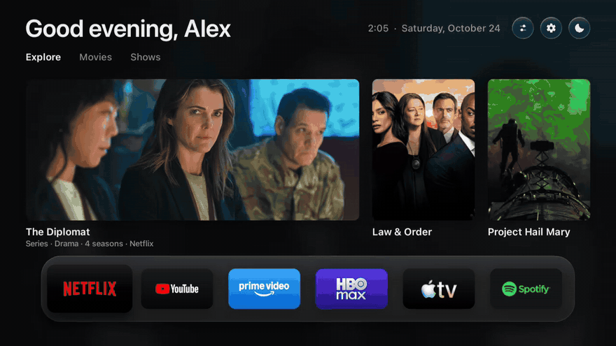

</div>

## Advantages

| | |
|---|---|
| **No ads** | Eliminates sponsored rows, intrusive banners, and autoplaying promotional videos that stock home screens force on you. |
| **Spyware and telemetry blocked** | Disables background ad tracking, Automatic Content Recognition (ACR), and factory analytics that monitor viewing habits. |
| **Faster and responsive** | Just 154 ms to display the home screen (compared to 217 ms on the stock launcher). Rendered directly on the GPU at 60 fps. |
| **More free RAM** | Shuts down background factory bloatware and resident services, freeing critical memory on 1 GB and 1.5 GB TVs. |
| **Complete privacy** | No account, login, or registration required. No personal information is gathered, stored, or sent to external servers. |
| **Fully reversible and safe** | Uninstalls nothing from the system. One click in *Launcher → Original* brings back stock settings, and an automated watchdog restores original mode if crashes occur. |
| **Free and open source** | No subscriptions, paywalls, or hidden limitations. |

## Features

| Feature | Description |
|---|---|
| **Control Center** | Quick-access side panel to switch Bluetooth audio devices (headphones and soundbars), adjust volume, toggle picture modes (on supported TVs), change themes, and launch AirPlay. |
| **Sports, teams, and athletes** | Track your clubs (soccer, basketball, football) across leagues and cups (Champions League, Premier League, Libertadores, etc.), plus individual athletes (ATP/WTA tennis players, Formula 1 drivers, UFC fighters, and PGA golfers). Public real-time data from ESPN with no account needed. Show the Sports tab first or last in *Settings → Home Screen → Tab order*. |
| **Custom screensaver** | Full-screen photo showcase with live clock, date, and local weather. Six brightness settings including matte and ultra-dark levels optimized for bedrooms and OLED panels. |
| **Phone photo uploads** | Send photos straight from your phone to the TV screensaver over local Wi-Fi via QR code, protected by a temporary server and PIN security. |
| **Remote button remapping** | Assign any button on your remote to launch a chosen app, open the Control Center, or bring up TV settings. Native detection for dedicated factory buttons on TCL, Sony, Vestel, KTC, and Formovie remotes. |
| **Streaming highlights** | Curated trending picks drawn exclusively from streaming services installed on your TV (powered by the free TMDB API). |
| **Adaptive themes** | Light, dark, or automatic theme synchronized with sunrise and sunset times for your location. |
| **Performance mode** | Dedicated low-overhead mode designed to minimize memory consumption on entry-level hardware. |
| **Full multilingual support** | Available in English, Portuguese, and Spanish. |

## What it turns off

**Why debloat?** Modern Smart TVs arrive loaded with manufacturer background services: automatic content recognition (ACR) that monitors what you watch to serve targeted advertisements, retail store demos, diagnostic logging, and sponsored promo channels. These services consume scarce RAM, congest local networks, and cause interface lag.

When you switch to GB Home TV, it **safely disables** (never uninstalls) only known non-essential packages in these categories:

| Category | What is disabled |
|---|---|
| **Ad-supported channels** | TCL Channel, Mi TV+, Coolita, and partner promotional streams. |
| **Ad telemetry and spyware** | Anoki ACR (automatic screen surveillance), Xiaomi/TCL analytical collectors, and Android advertising ID targeting. |
| **Store demos** | Retail store mode, promotional video loops, and resident demo manuals. |
| **Diagnostic logging** | Background crash log reporting and manufacturer diagnostic guides. |

**Never modified:** Picture processing, sound engines, HDMI inputs, remote control pairing, operating system updates, and core Google services. *Launcher → Original* restores every disabled app immediately. Full audited list available in [`HomeMode.java`](app/src/io/freemytv/HomeMode.java).

## Memory and speed

On entry-level Smart TVs with 1 GB or 1.5 GB of RAM (many TCL, Xiaomi, and Redmi models), freeing up RAM directly improves streaming app smoothness:

1. **Debloated background:** Turning off manufacturer telemetry and promotional channels eliminates unnecessary CPU and memory overhead.
2. **Performance Mode:** In *Settings → Performance → Mode*, switch to *Performance* to turn off heavy recommendation queries and slow zoom animations, saving additional RAM.
3. **AirPlay management:** AirPlay receiver apps consume considerable RAM while active (~40 MB measured). On low-RAM hardware, exit the receiver when not actively casting.

Real performance without inflated claims: GB Home TV opens faster and animates cleanly at 60 fps because its UI is drawn directly on the canvas without heavy, embedded web frameworks. *Settings → About* displays real-time benchmarks measured on your own TV.

## Screenshots

| | |
|---|---|
| **Home screen** | 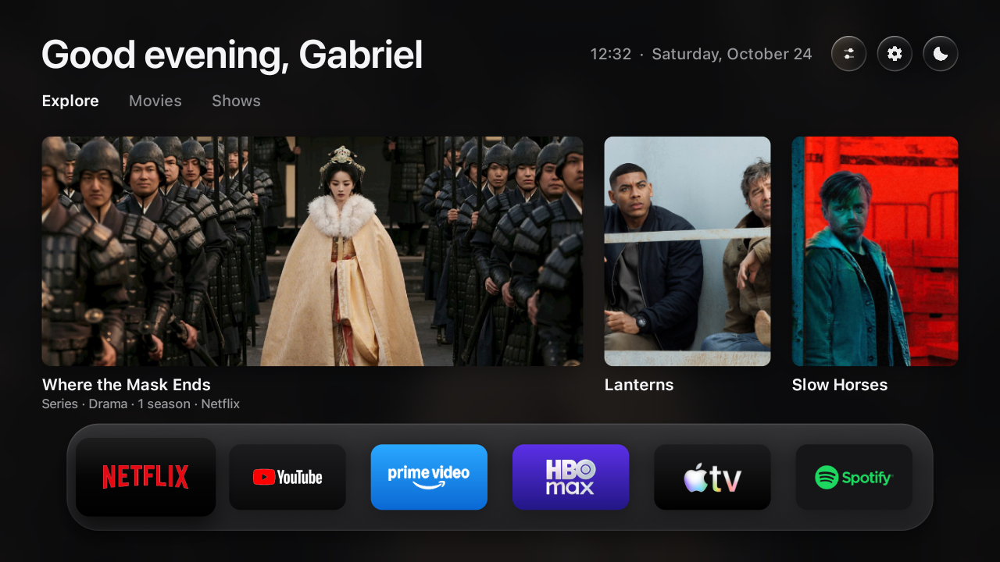 |
| **Drawer** | 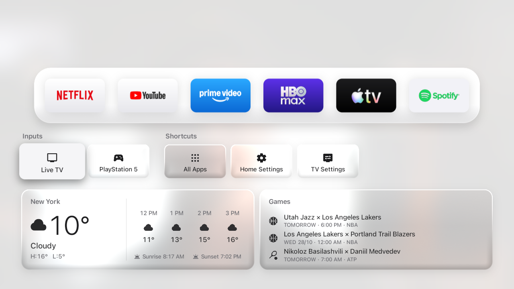 |
| **Control Center** | 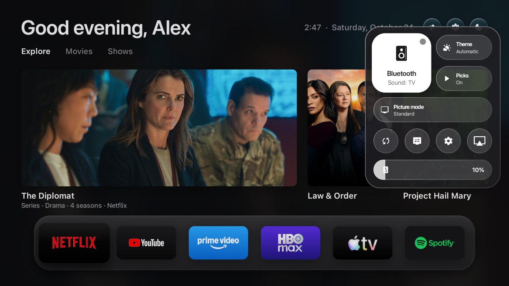 |
| **Settings** | 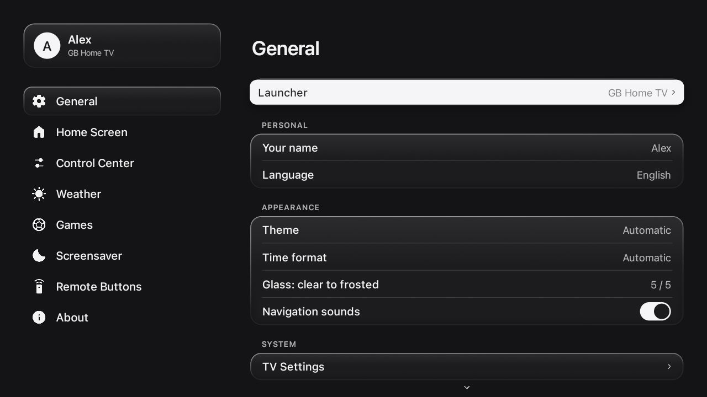 |
| **Sports tab** | 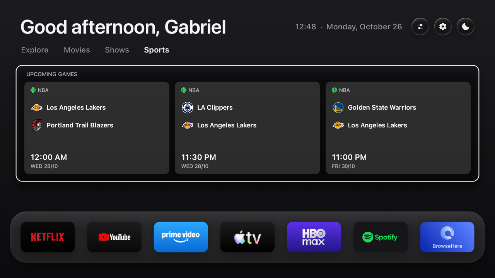 |
| **Sports settings** | 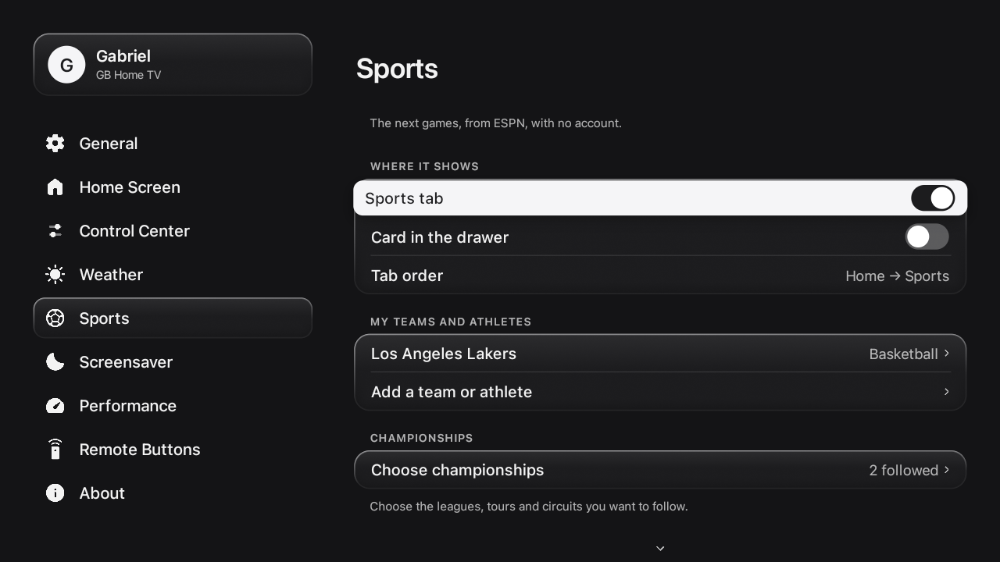 |
| **Screensaver** | 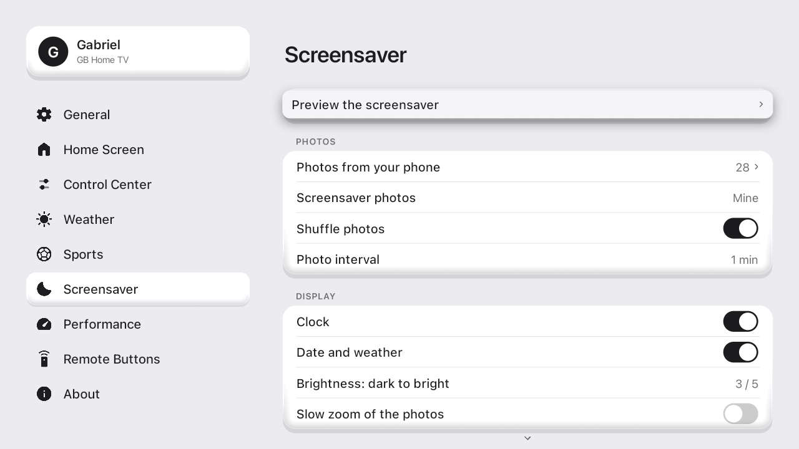 |
| **Performance** | 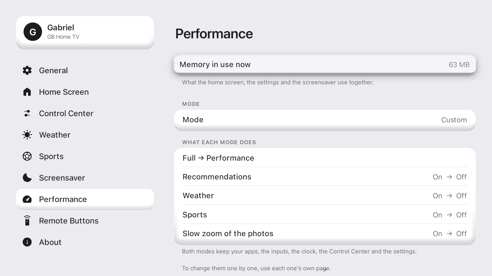 |
| **Remote buttons** | 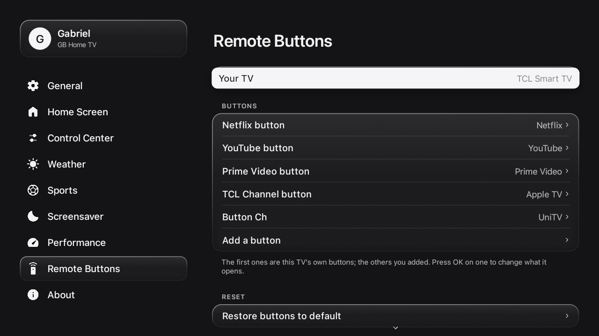 |
| **Phone photo upload** | 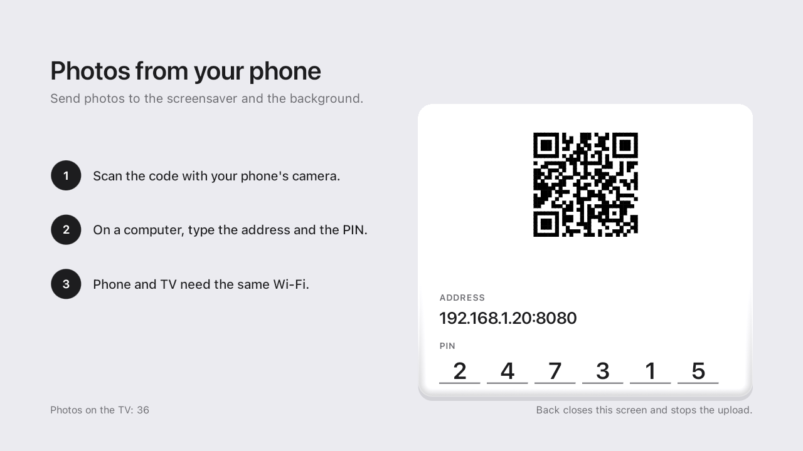 |

In motion: [Control Center](docs/assets/en/control-center.webp) · [Settings](docs/assets/en/settings.webp) · [Screensaver](docs/assets/en/screensaver.mp4)

## Installation

**Requirements:** A TV, TV box or streamer running Google TV or Android TV (Android 8 or newer) and a computer connected to the same Wi-Fi network.

### 1. Prepare the TV

1. Navigate to *Settings → System → About*: press **Build number** (or *Android TV OS build*) **7 times** to unlock Developer options.
2. Under *Settings → System → Developer options*: enable **USB debugging** (or *Network debugging*).
3. Under *Settings → Network & Internet* → select your Wi-Fi network and note down the **IP address** (e.g. `192.168.0.137`).

### 2A. Installation with an AI assistant (easiest)

Open an AI coding assistant ([Claude Code](https://claude.com/claude-code), Codex, Antigravity…) and provide the following prompt using your TV's IP:

> Install GB Home TV (github.com/gabrielbaumgratz/LauncherGB) on my TV at 192.168.0.137.

The assistant will download, compile, and install the package. When the TV prompts *Allow USB debugging?*, tick *Always allow* and accept.

### 2B. Manual installation

```bash
# Requirements: JDK 17+, Android SDK (build-tools 34, android-34), and adb
./build.sh                                 # compiles GBHomeTV.apk
adb connect 192.168.0.137:5555             # your TV IP address
adb install -r GBHomeTV.apk
```

- **TCL TVs:** also execute `adb shell "appops set io.freemytv AUTO_START allow || appops set io.freemytv APP_AUTO_START allow"`.
- **macOS / Linux:** install tools via your package manager (`brew install --cask temurin android-commandlinetools android-platform-tools`). **Windows:** use Git Bash or WSL.
- Retain `freemytv.keystore`: subsequent updates require signing with the same key.

### 3. Activation on TV

Open **GB Home TV → General → Launcher → GB Home TV** and confirm the local ADB prompt on screen. Press the Home button on your remote to view the new interface.

## After installing

Optional customizations to enhance your setup:

### Personalized streaming recommendations (TMDB key)

Shows trending titles available on streaming platforms installed on your TV:

1. Register a free account at [themoviedb.org](https://www.themoviedb.org/signup) and confirm your email.
2. Go to Profile → *Settings* → *API* → request a **Developer** key (stated purpose: "personal TV home screen").
3. Copy the **API Read Access Token**.
4. In `config.properties` (generated on first `./build.sh`), paste the token after `tmdb_key=` without quotes or spaces.
5. Rebuild and install (`./build.sh` followed by `adb install -r GBHomeTV.apk`).

<details>
<summary>Options in <code>config.properties</code></summary>

| Key | Purpose | Default |
|---|---|---|
| `tmdb_region` | Two-letter country code (e.g. US, BR, ES) | TV region |
| `latitude`, `longitude`, `city` | Coordinates and location for weather and sunset | auto by timezone |
| `language` | Interface language (`auto`, `en`, `pt`, `es`) | `auto` |
| `temperature` | Temperature scale (`C`, `F`, or `auto`) | `auto` |

</details>

### AirPlay support

GB Home TV provides the integration tile in Control Center; media streaming reception is handled by the open-source companion [android-airplay-server](https://github.com/jqssun/android-airplay-server) (jqssun, GPL-3.0):

1. Download the `.apk` from the [Releases](https://github.com/jqssun/android-airplay-server/releases) page.
2. Install via adb: `adb install -r file.apk`.
3. The **AirPlay** button will appear in the Control Center. From your Apple device (iPhone, iPad, Mac), select the TV in the AirPlay menu.

### Phone photo uploads

Go to *Settings → Screensaver → Photos from your phone*. Scan the QR code displayed on the TV (or open the local URL and PIN in a browser) to upload photos straight to your TV's private storage.

## How to use

| Action | Destination |
|---|---|
| **Home button** | Main screen with your glass app shelf and highlight tabs. |
| **D-pad Down** | Drawer featuring HDMI inputs, system settings, weather, and sports. |
| **Top circular icon** | Fast Control Center (Bluetooth, volume, picture mode, themes, and AirPlay). |
| **Gear icon** | Full settings and configuration menu. |
| **Idle TV** | Ambient screensaver with personal photos, clock, and weather. |

## FAQ

**Can this damage my TV?** No. GB Home TV runs as a standard user-space Android application. It does not modify system partitions, does not alter firmware, and does not delete system files.

**How do I return to the stock launcher?** Open *Settings → General → Launcher → Original*. All disabled manufacturer services are immediately re-enabled.

**Which devices are supported?** Any TV, TV box or streamer running Google TV or Android TV (Android 8 and up): TCL, Sony, Xiaomi, Philips and other smart TVs, plus boxes and sticks such as the Mi Box, onn., Chromecast with Google TV and NVIDIA Shield. LG (webOS) and Samsung (Tizen) devices do not run Android; connecting a Google TV streaming device via HDMI is recommended.

**Does it collect data?** No. Network access is strictly limited to services you enable: weather data (Open-Meteo), streaming highlights (TMDB, via your private key), and sports fixtures (public ESPN).

## Build it yourself

Built without Gradle or heavy dependencies, using only standard Android SDK command-line utilities:

```bash
export ANDROID_HOME="/path/to/android/sdk"
./build.sh            # outputs signed GBHomeTV.apk
tools/check.sh        # runs build and translation validations
```

## Credits

Created and maintained by [Gabriel Baumgratz](https://github.com/gabrielbaumgratz), originally inspired by [Free My TV](https://github.com/simbasjungles/free-my-tv).

- **[Free My TV](https://github.com/simbasjungles/free-my-tv)** (MIT): original project foundation.
- **Apple TV (tvOS)**: the visual inspiration for the home screen, tabs and Control Center. GB Home TV is an independent project, not affiliated with or endorsed by Apple.
- **[android-airplay-server](https://github.com/jqssun/android-airplay-server)**, by jqssun (GPL-3.0): companion AirPlay receiver.
- **[Material Symbols](https://fonts.google.com/icons)** (Apache 2.0): interface iconography.
- **[TMDB](https://www.themoviedb.org)**: streaming recommendations and artwork metadata.
- **[Open-Meteo](https://open-meteo.com)**: weather forecasts. **ESPN**: public sports fixtures.

## License

[MIT](LICENSE).
