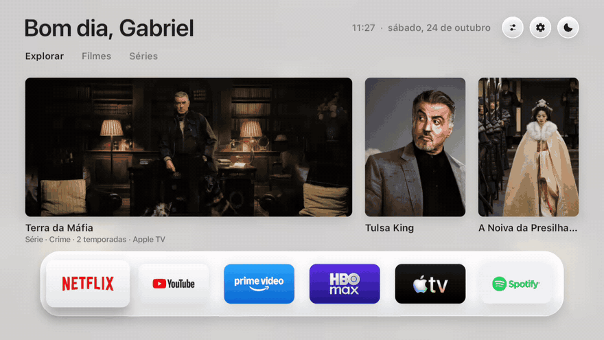
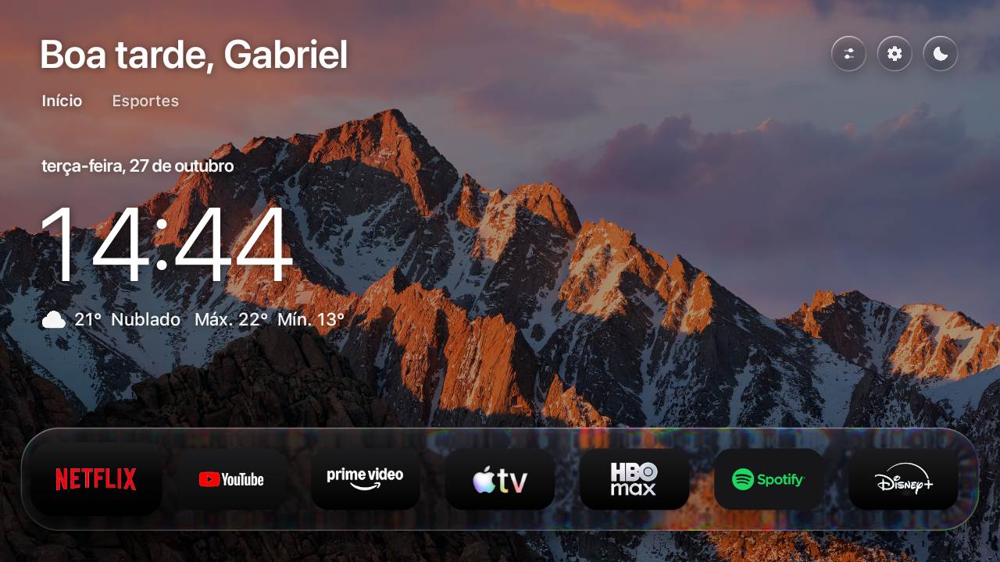
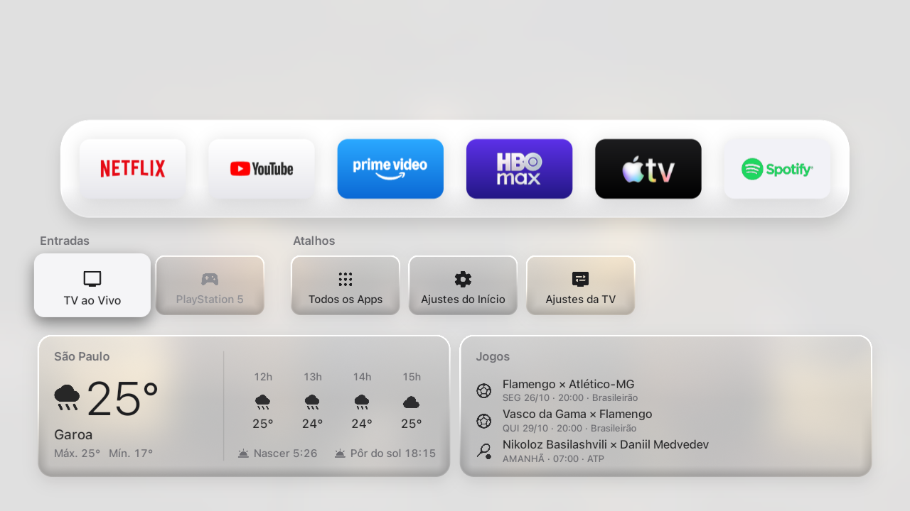
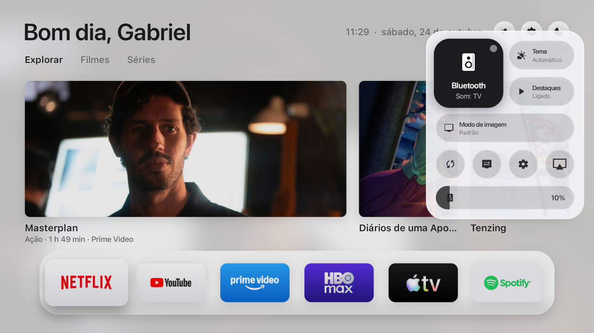
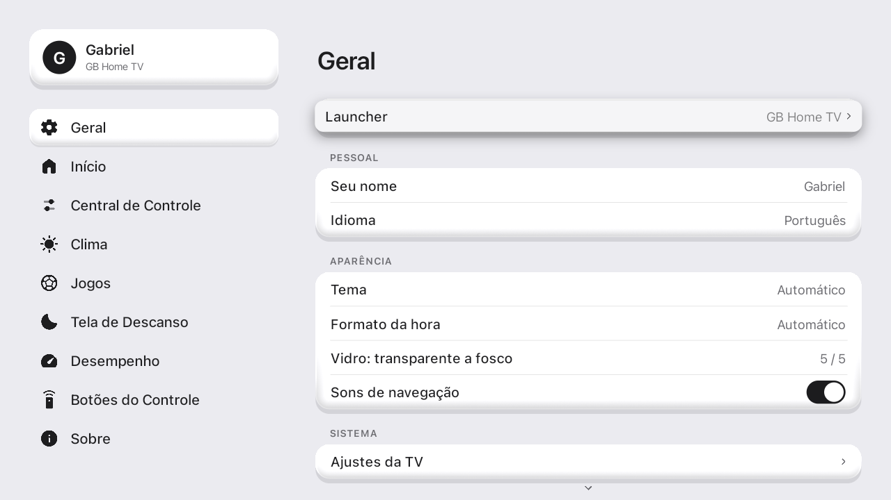
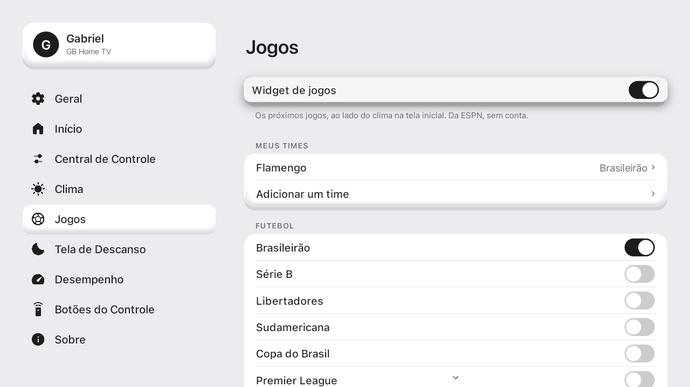
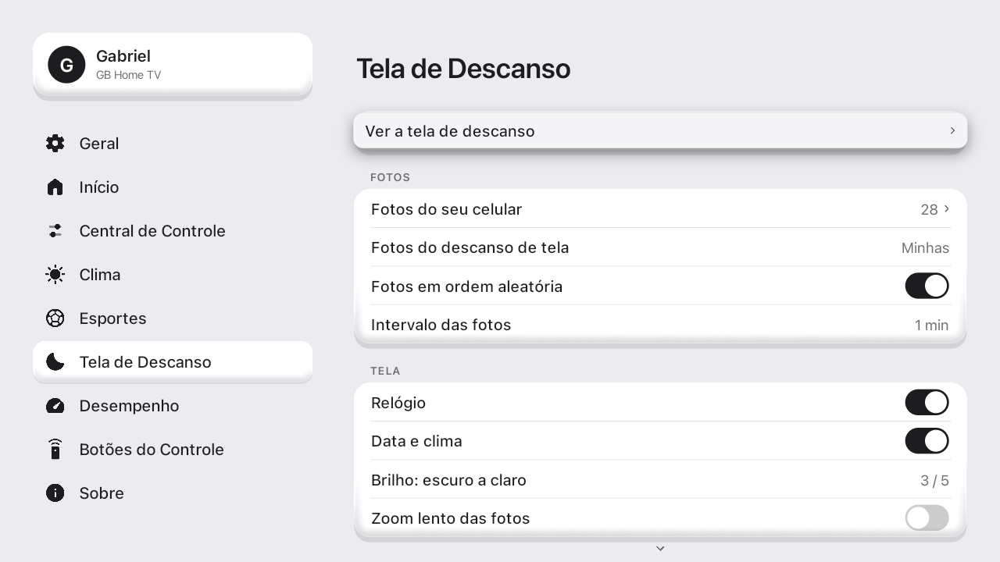
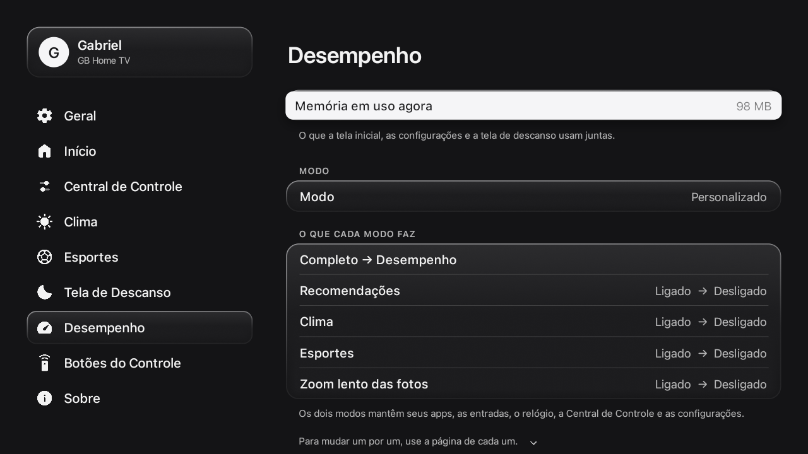
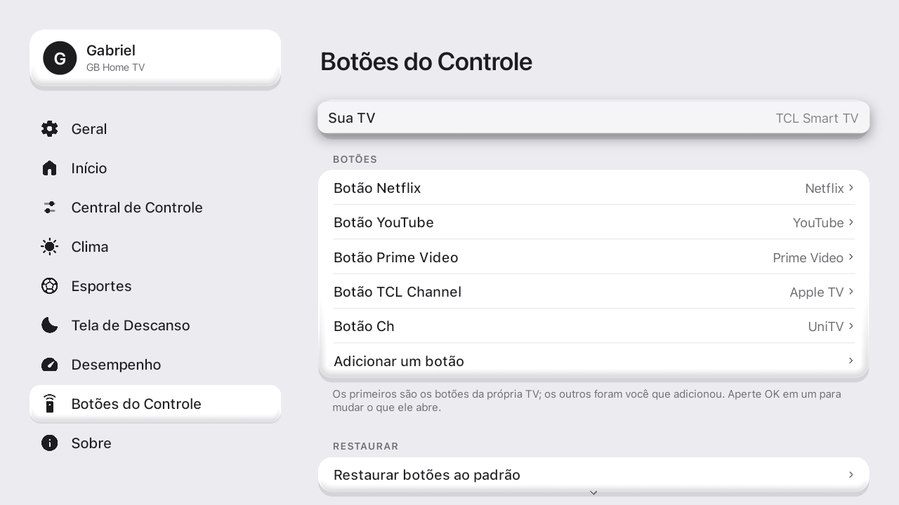
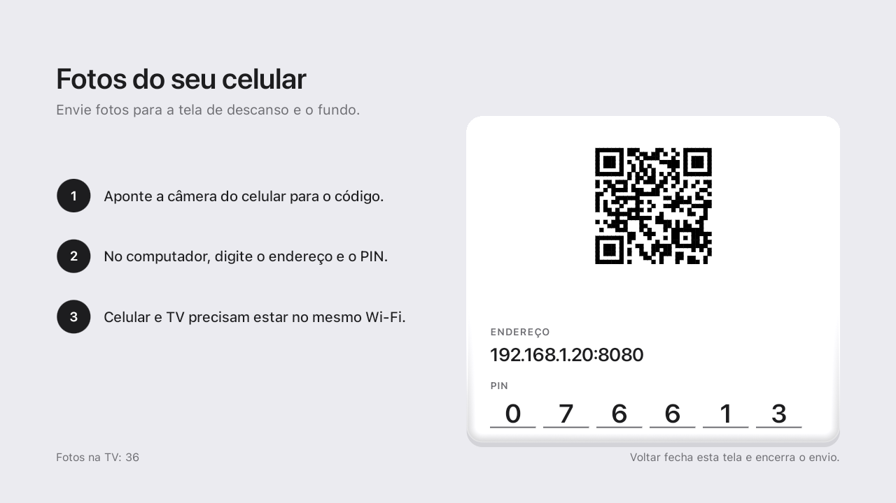

<div align="center">

<picture>
  <source media="(prefers-color-scheme: dark)" srcset="docs/assets/logo-white.png">
  
</picture>

# GB Home TV

**Sua TV mais rápida, leve e livre de anúncios e spywares.**<br>
Elimine propagandas invasivas e rastreadores de fábrica da sua Google TV ou Android TV com um clique. Totalmente reversível.

[English](README.md) · Português · [Español](README.es.md)

[Vantagens](#vantagens) · [Funcionalidades](#funcionalidades) · [Instalação](#instalação) · [O que ele desliga](#o-que-ele-desliga) · [Memória e desempenho](#memória-e-desempenho) · [Como usar](#como-usar) · [Depois de instalar](#depois-de-instalar) · [Perguntas frequentes](#perguntas-frequentes)



</div>

## Vantagens

| | |
|---|---|
| **Sem anúncios** | Elimina linhas patrocinadas, banners invasivos e vídeos comerciais que iniciam sozinhos na tela inicial da TV. |
| **Bloqueio de spyware e telemetria** | Desativa serviços de rastreamento de anúncios, reconhecimento automático de conteúdo (ACR) e coleta de dados em segundo plano dos fabricantes. |
| **Mais rápida e responsiva** | Apenas 154 ms para exibir a tela inicial (contra 217 ms da tela de fábrica). Interface desenhada direto na GPU em 60 quadros por segundo. |
| **Mais memória RAM livre** | Desativa apps pesados e lixo de fábrica que consomem memória em segundo plano, liberando recursos essenciais para TVs de 1 GB e 1.5 GB. |
| **Privacidade garantida** | Sem necessidade de login, conta ou cadastro. Não armazena nem envia dados pessoais para servidores externos. |
| **Totalmente reversível e segura** | Não desinstala nada do sistema. Um clique em *Launcher → Original* restaura tudo como veio de fábrica, e o sistema vigia retorna à tela original se houver qualquer problema. |
| **Gratuita e de código aberto** | Sem cobranças, assinaturas ou recursos bloqueados. |

## Funcionalidades

| Recurso | Descrição |
|---|---|
| **Central de Controle** | Painel lateral instantâneo para alternar saídas de áudio Bluetooth (fones e caixas), volume, modo de imagem (em TVs suportadas), tema e atalho para receptor AirPlay. |
| **Esportes, times e atletas** | Acompanhe seus clubes (futebol, basquete, futebol americano) em ligas e copas (Brasileirão, Libertadores, Copa do Brasil, etc.), além de atletas individuais (tenistas no ranking ATP/WTA, pilotos de Fórmula 1, lutadores do UFC e golfistas). Dados públicos direto da ESPN, sem precisar de conta. |
| **Tela de descanso personalizada** | Fotos em tela cheia com relógio, data e previsão do tempo local. Seis níveis de brilho (incluindo nível fosco e ultra-escuro para quartos e painéis OLED). |
| **Fotos direto do celular** | Envie fotos do celular para a tela de descanso da TV via Wi-Fi local através de QR code, com servidor temporário e autenticação por PIN. |
| **Mapeamento do controle remoto** | Configure qualquer botão do controle remoto para abrir o app desejado, a Central de Controle ou os ajustes da TV. Compatibilidade nativa com botões dedicados de marcas como TCL, Sony, Vestel, KTC e Formovie. |
| **Destaques dos seus streamings** | Vitrine com os títulos em alta exclusivamente dos serviços de streaming que você possui instalados na TV (via API gratuita do TMDB). |
| **Temas adaptativos** | Tema claro, escuro ou automático sincronizado com o horário do nascer e pôr do sol da sua cidade. |
| **Modo Desempenho** | Configuração especial para otimizar ao máximo o uso de memória em TVs com hardware mais modesto. |
| **Internacionalização completa** | Interface adaptada para Português, Inglês e Espanhol. |

## O que ele desliga

**Por que desativar?** As TVs modernas saem de fábrica carregadas de softwares de fábrica que executam processos contínuos em segundo plano: medição do que você assiste para venda de anúncios direcionados (ACR), canais de demonstração comercial, coleta analítica e telemetria do fabricante. Isso consome a memória RAM limitada da TV, satura a rede e torna a navegação lenta e travada.

Ao ativar o GB Home TV, ele **desativa com segurança** (sem jamais desinstalar arquivos do sistema) apenas os pacotes identificados dessa categoria:

| Categoria | O que é desativado |
|---|---|
| **Canais com propaganda** | TCL Channel, Mi TV+, Coolita e canais promocionais de parceiros. |
| **Spyware e telemetria de anúncios** | Anoki ACR (reconhecimento automático de tela), serviços analíticos da Xiaomi/TCL e segmentação de anúncios do Android. |
| **Demonstrações de loja** | Modo vitrine de loja, vídeos de demonstração e manuais promocionais residentes. |
| **Serviços de diagnóstico e logs** | Coletores automáticos de relatórios em segundo plano e guias de suporte de fabricantes. |

**Componentes que nunca são alterados:** Imagem, som, entradas HDMI, controle remoto, atualizações do sistema operacional e serviços essenciais do Google. A opção *Launcher → Original* reativa tudo instantaneamente. Veja a lista completa e auditada em [`HomeMode.java`](app/src/io/freemytv/HomeMode.java).

## Memória e desempenho

Em Smart TVs de entrada de 1 GB ou 1.5 GB de RAM (muitos modelos TCL, Xiaomi e Redmi), cada megabyte economizado faz diferença direta na fluidez dos apps de vídeo:

1. **Desativação de bloatwares:** O desligamento dos serviços de telemetria e canais promocionais do fabricante alivia o processamento em segundo plano.
2. **Modo Desempenho:** Em *Configurações → Desempenho → Modo*, você pode alternar para o modo *Desempenho*, que desativa widgets pesados e animações de zoom longo, economizando RAM adicional.
3. **Uso consciente do AirPlay:** Aplicativos receptores de AirPlay consomem memória considerável enquanto ativos (~40 MB medidos). Em TVs de pouca RAM, feche o receptor quando não estiver transmitindo.

Sem números maquiados: o GB Home TV abre mais rápido e responde instantaneamente por desenhar sua interface diretamente na GPU sem camadas de navegadores web lentos. *Configurações → Sobre* exibe a medição exata de memória e tempo de abertura na sua TV.

## Capturas

| | |
|---|---|
| **Tela inicial** |  |
| **Gaveta** |  |
| **Central de Controle** |  |
| **Configurações** |  |
| **Esportes** |  |
| **Tela de descanso** |  |
| **Desempenho** |  |
| **Botões do controle** |  |
| **Fotos do celular** |  |

Em movimento: [Central de Controle](docs/assets/pt/control-center.webp) · [Configurações](docs/assets/pt/settings.webp) · [Tela de descanso](docs/assets/pt/screensaver.mp4)

## Instalação

**Requisitos:** Uma TV com Google TV ou Android TV (Android 8 ou superior) e um computador conectado na mesma rede Wi-Fi.

### 1. Preparar a TV

1. Vá em *Configurações → Sistema → Sobre*: pressione **7 vezes** sobre *Versão do Android TV OS* (ou *Número da versão*) até ativar o modo desenvolvedor.
2. Em *Configurações → Sistema → Opções do desenvolvedor*: ative a opção **Depuração USB** (ou *Depuração de rede*).
3. Em *Configurações → Rede e Internet* → selecione sua rede Wi-Fi e anote o **endereço IP** (exemplo: `192.168.0.137`).

### 2A. Instalação com assistente de IA (mais simples)

Abra um assistente de código ([Claude Code](https://claude.com/claude-code), Codex, Antigravity…) e envie a seguinte instrução com o IP da sua TV:

> Instale o GB Home TV (github.com/gabrielbaumgratz/LauncherGB) na minha TV em 192.168.0.137.

O assistente baixa, compila e instala o aplicativo. Na TV, quando surgir o aviso *Permitir depuração USB?*, marque a opção *Sempre permitir* e confirme.

### 2B. Instalação manual

```bash
# Requisitos: JDK 17+, Android SDK (build-tools 34, android-34) e adb
./build.sh                                 # compila o GBHomeTV.apk
adb connect 192.168.0.137:5555             # substitua pelo IP da sua TV
adb install -r GBHomeTV.apk
```

- **TVs TCL:** execute também `adb shell "appops set io.freemytv AUTO_START allow || appops set io.freemytv APP_AUTO_START allow"`.
- **macOS / Linux:** instale as dependências via gerenciador de pacotes (`brew install --cask temurin android-commandlinetools android-platform-tools`). **Windows:** utilize Git Bash ou WSL.
- Mantenha o arquivo `freemytv.keystore`: atualizações subsequentes exigem a mesma chave de assinatura.

### 3. Ativação na TV

Abra **GB Home TV → Geral → Launcher → GB Home TV** e confirme a autorização de depuração local na tela da TV. Pressione a tecla Início (Home) no controle: a nova tela inicial estará pronta.

## Depois de instalar

Configurações opcionais adicionais para enriquecer a experiência:

### Recomendações personalizadas de streaming (TMDB)

Exibe os títulos populares e em alta dos apps de streaming presentes na sua TV:

1. Crie uma conta gratuita em [themoviedb.org](https://www.themoviedb.org/signup) e confirme seu e-mail.
2. Acesse seu perfil → *Configurações* → *API* → solicite uma chave do tipo **Developer** (finalidade: "uso pessoal em tela inicial de TV").
3. Copie o **API Read Access Token**.
4. No arquivo `config.properties` (gerado na primeira compilação pelo `./build.sh`), cole o token após `tmdb_key=`, sem espaços ou aspas.
5. Compile e instale novamente (`./build.sh` e `adb install -r GBHomeTV.apk`).

<details>
<summary>Opções do <code>config.properties</code></summary>

| Chave | Função | Padrão |
|---|---|---|
| `tmdb_region` | Código do seu país (duas letras, ex: BR) | o da TV |
| `latitude`, `longitude`, `city` | Coordenadas e cidade para clima e pôr do sol | determinado pelo fuso |
| `language` | Idioma de exibição (`auto`, `pt`, `en`, `es`) | `auto` |
| `temperature` | Unidade de temperatura (`C`, `F` ou `auto`) | `auto` |

</details>

### Suporte a AirPlay

O GB Home TV fornece a integração e botão na Central de Controle; a recepção de vídeo e áudio é realizada pelo app aberto [android-airplay-server](https://github.com/jqssun/android-airplay-server) (jqssun, GPL-3.0):

1. Baixe o `.apk` na aba [Releases](https://github.com/jqssun/android-airplay-server/releases).
2. Instale via adb: `adb install -r arquivo.apk`.
3. O botão **AirPlay** passará a aparecer na Central de Controle. No seu dispositivo Apple (iPhone, iPad, Mac), basta selecionar a TV no menu AirPlay.

### Fotos direto do celular

Acesse *Configurações → Tela de Descanso → Fotos do seu celular*. Aponte a câmera para o QR code exibido na TV (ou acesse o endereço e PIN em um computador na mesma rede) para carregar imagens diretamente para o armazenamento local da TV.

## Como usar

| Ação | O que abre |
|---|---|
| **Tecla Início (Home)** | Tela principal com sua prateleira de apps em vidro e abas de destaques. |
| **Seta para baixo** | A gaveta com atalhos de entradas HDMI, configurações, clima e esportes. |
| **Primeiro botão circular superior** | Central de Controle rápida (Bluetooth, volume, imagem, tema e AirPlay). |
| **Ícone de engrenagem** | Menu completo de configurações do sistema e personalização. |
| **Inatividade da TV** | Tela de descanso elegante com fotos, relógio e previsão do tempo. |

## Perguntas frequentes

**Pode danificar minha TV?** Não. Trata-se de um aplicativo Android padrão em Java que opera no espaço de usuário. Ele não faz modificações no firmware, não altera partições do sistema e não remove nenhum arquivo essencial.

**Como volto para a tela de fábrica?** Abra *Configurações → Geral → Launcher → Original*. Todos os serviços do fabricante desligados são religados instantaneamente.

**Quais televisores são compatíveis?** Compatível com qualquer televisor ou dispositivo com Google TV ou Android TV (Android 8 em diante): TCL, Sony, Xiaomi, Philips, onn., Chromecast com Google TV, NVIDIA Shield, entre outros. Aparelhos LG (webOS) e Samsung (Tizen) não utilizam Android, recomendando-se o uso de um reprodutor Google TV conectado via HDMI.

**O aplicativo coleta dados pessoais?** Absolutamente não. As únicas requisições de rede feitas são para os serviços que você optar por utilizar: previsão do tempo (Open-Meteo), destaques de streaming (TMDB, mediante sua chave pessoal) e placares de esportes (ESPN pública).

## Compilação

O projeto foi construído sem o uso de Gradle ou dependências externas pesadas, utilizando apenas o Android SDK:

```bash
export ANDROID_HOME="/caminho/do/android/sdk"
./build.sh            # gera o GBHomeTV.apk assinado
tools/check.sh        # executa validações de integridade e catálogos de tradução
```

## Créditos

Criado e mantido por [Gabriel Baumgratz](https://github.com/gabrielbaumgratz), baseado inicialmente no [Free My TV](https://github.com/simbasjungles/free-my-tv).

- **[Free My TV](https://github.com/simbasjungles/free-my-tv)** (MIT): projeto base original de onde o launcher evoluiu.
- **[android-airplay-server](https://github.com/jqssun/android-airplay-server)**, por jqssun (GPL-3.0): receptor auxiliar de AirPlay.
- **[Material Symbols](https://fonts.google.com/icons)** (Apache 2.0): ícones de interface.
- **[TMDB](https://www.themoviedb.org)**: dados de destaques e recomendações de streaming.
- **[Open-Meteo](https://open-meteo.com)**: previsão meteorológica. **ESPN**: placares e dados esportivos públicos.

## Licença

[MIT](LICENSE).
