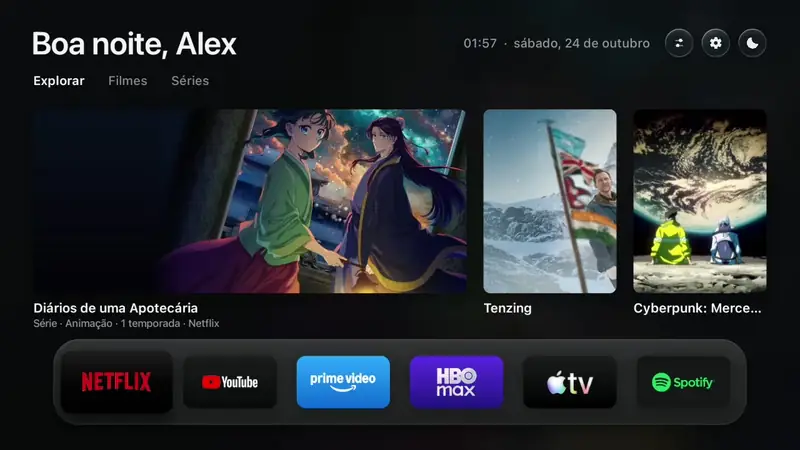
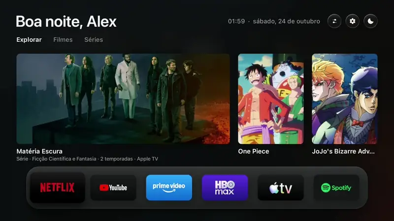
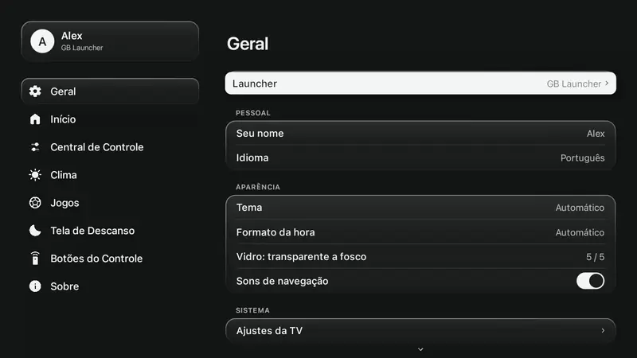
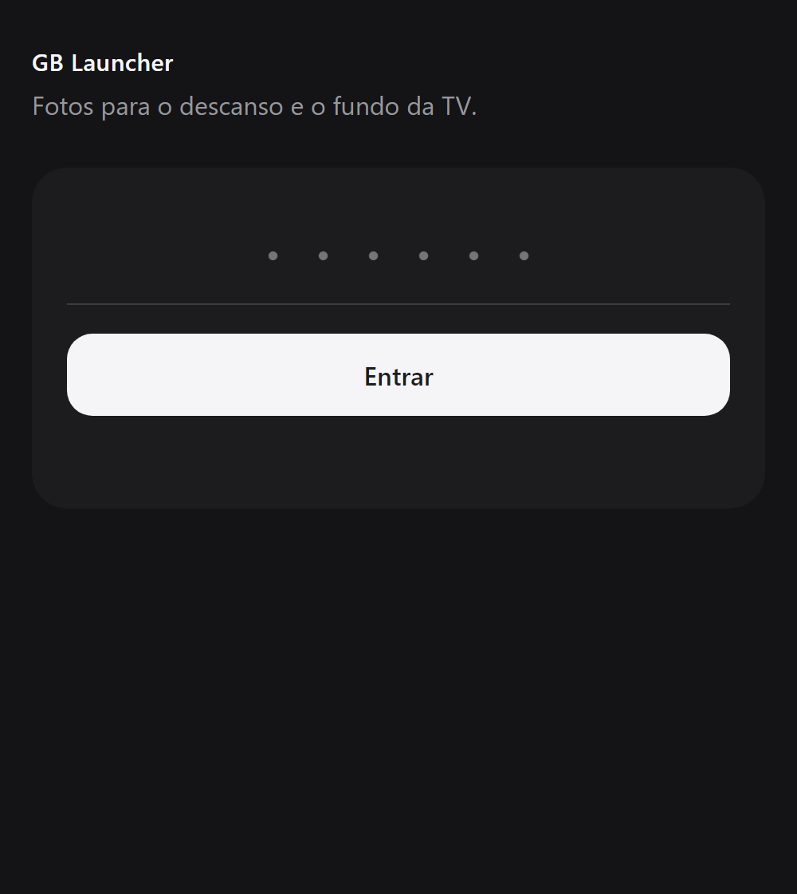

<div align="center">

<picture>
  <source media="(prefers-color-scheme: dark)" srcset="docs/assets/logo-white.png">
  
</picture>

# GB Launcher

**Uma tela inicial rápida e sem anúncios para Google TV e Android TV, com um visual que bebe do tvOS.**

Código aberto, feito para qualquer pessoa usar. Criado por [Gabriel Baumgratz](https://github.com/gabrielbaumgratz), inspirado no [Free My TV](https://github.com/simbasjungles/free-my-tv).<br>
Sem anúncios, Central de Controle, suas fotos na tela de descanso, widget de jogos. Um botão para desfazer.

[English](README.md) · Português

[O que você ganha](#o-que-você-ganha) · [Capturas](#capturas-de-tela) · [Medido](#medido-numa-tv-de-verdade) · [Instalar](#instalar) · [AirPlay](#airplay) · [Configurações](#configurações) · [Compilar](#compile-você-mesmo) · [Créditos](#créditos)


</div>

## O que você ganha

- **Sem anúncios.** Nada de linhas patrocinadas, banners ou vídeos que começam sozinhos.
- **Seus apps na frente.** Uma prateleira de vidro com os apps que você escolhe, na ordem que você escolhe, editada na própria TV.
- **Destaques dos apps que você tem.** Três abas (Explorar, Filmes, Séries), alimentadas pelo TMDB com a sua chave gratuita. Sem chave, o resto continua funcionando.
- **Uma Central de Controle.** Aperte o botão de informação do controle (ou o primeiro botão redondo no topo): fone Bluetooth com um clique, volume, tema claro e escuro, modo de imagem e AirPlay. Você escolhe quais blocos ela mostra.
- **Uma gaveta um toque abaixo.** Entradas HDMI com marcador de sinal, atalhos, o clima com previsão hora a hora e o widget de jogos.
- **Um widget de jogos.** Escolha seus times e os campeonatos que você segue (futebol, basquete, NFL, beisebol, hóquei, tênis) e os próximos jogos ficam ao lado da previsão, cada um com o símbolo do seu esporte. Os dados vêm da ESPN, sem chave.
- **Uma tela de descanso legível do sofá.** Fotos em tela cheia com acabamento fosco, um relógio fosco e translúcido no canto superior esquerdo, data e clima no canto superior direito. Fotos em ordem ou aleatórias, e você escolhe o quanto ela escurece para um quarto apagado.
- **Fotos do celular.** Aponte a câmera para o QR code na TV (ou, no computador, digite o endereço e o PIN) e envie fotos para a tela de descanso e o fundo. Só na rede local.
- **Configurações no estilo do iPad.** Categorias numa barra lateral, cartões agrupados à direita. Os cartões, o foco e as cores são os da própria tela inicial: preto ou branco, conforme o tema.
- **Dispositivos Bluetooth.** Escolha quais fones aparecem na tela inicial, dê a eles um nome seu ou esqueça de vez.
- **Seu nome.** "Bom dia, Ana": digite o nome que quiser nas configurações, ou deixe vazio.
- **Botões do controle que abrem o que você quer.** Netflix, YouTube, Prime Video e os botões das marcas (TCL, Sony, Vestel, KTC, Formovie) podem abrir qualquer app instalado.
- **Português, inglês e espanhol.** Escolhidos nas configurações ou iguais aos da TV.
- **Seguro.** Sem root. Nada é desinstalado. *Launcher → Original* devolve a tela inicial de fábrica, e um vigia faz isso sozinho depois de travamentos repetidos.

## Capturas de tela

| | Português | English |
|---|---|---|
| Início |  |  |
| Gaveta |  |  |
| Central de Controle |  |  |
| Configurações |  |  |
| Jogos |  |  |
| Tela de descanso |  |  |
| Botões do controle |  |  |
| Fotos do celular |  |  |

### Em movimento

| Um toque para baixo: entradas, clima, jogos | A Central de Controle | Configurações |
|---|---|---|
|  |  |  |

A tela de descanso:  · [vídeo](docs/assets/pt/screensaver.mp4) · [in English](docs/assets/en/screensaver.mp4)

A página no celular: 

## Medido numa TV de verdade

A página Sobre do app mede as duas telas iniciais na sua própria TV e mostra lado a lado. Estes são os números que ela mostrou numa TCL 32S5K (Google TV, Android 14), sem arredondar a favor do GB Launcher:

| | Tela inicial original | GB Launcher |
|---|---|---|
| Tempo do botão Início até mostrar a tela inicial | 217 ms | 154 ms |
| Memória livre na TV | 289 MB | 165 MB |
| Memória usada pela tela inicial | 89 MB | 152 MB |

O GB Launcher abre mais rápido e não tem anúncios, mas desenha tudo sozinho e guarda as imagens na memória, então usa **mais** memória que a tela inicial de fábrica. Os seus números serão outros: abra *Configurações → Sobre* depois de trocar.

## Instalar

Você precisa de uma Google TV ou Android TV (Android 8 ou mais novo) e de um computador no mesmo Wi-Fi. Uns dez minutos.

### Com um assistente de IA

1. **Na TV**, ligue o modo desenvolvedor: Configurações → Sistema → Sobre → aperte *Versão do Android TV OS* 7 vezes. Depois Configurações → Sistema → Opções do desenvolvedor → ligue a **Depuração USB** (ou a depuração de rede). Anote o endereço IP da TV (Configurações → Rede e Internet).
2. **No computador**, abra um assistente de código com IA ([Claude Code](https://claude.com/claude-code), Codex ou Antigravity) e diga:
   > Instale o GB Launcher (github.com/gabrielbaumgratz/LauncherGB) na minha TV em 192.168.1.50. Eu moro em São Paulo.
3. **Na TV**, abra *GB Launcher* → *Launcher* → *GB Launcher*. A TV pergunta *Permitir depuração USB?*: marque *Sempre permitir* e aceite.

### À mão

1. **Na TV**, faça o passo 1 acima.
2. **Ferramentas:** um JDK 17+, as ferramentas de linha de comando do Android SDK (build-tools 34, plataforma android-34) e o adb.
   ```bash
   brew install --cask temurin android-commandlinetools android-platform-tools   # macOS
   sdkmanager "build-tools;34.0.0" "platforms;android-34"
   ```
   No Linux use o OpenJDK 17 e as ferramentas de linha de comando do Android; no Windows use o Git Bash ou o WSL.
3. **Compile:**
   ```bash
   ./build.sh
   ```
   A primeira execução cria o `config.properties`. Preencha sua cidade e, se quiser, sua [chave do TMDB](#a-chave-do-tmdb), e rode de novo. O resultado é o `GBLauncher.apk`.
4. **Instale:**
   ```bash
   adb connect 192.168.1.50:5555
   adb install -r GBLauncher.apk
   ```
   Em TVs TCL, permita também que ele rode em segundo plano (a TCL bloqueia por padrão, e a troca nunca começa):
   ```bash
   adb shell "appops set io.freemytv AUTO_START allow || appops set io.freemytv APP_AUTO_START allow"
   ```
5. **Na TV**, abra *GB Launcher* → *Launcher* → *GB Launcher* e aceite *Permitir depuração USB?* mais uma vez (agora para o próprio GB Launcher).

As atualizações precisam da mesma assinatura: guarde o `freemytv.keystore`.

**Testado em:** TCL 32S5K (Google TV, Android 14). Deve rodar em qualquer Android TV ou Google TV a partir do Android 8, como Sony Bravia, Chromecast com Google TV, Xiaomi Mi Box, Philips, onn. e NVIDIA Shield.

## AirPlay

O GB Launcher não traz um receptor de AirPlay. Ele funciona com um gratuito, o **[android-airplay-server](https://github.com/jqssun/android-airplay-server)**, do [jqssun](https://github.com/jqssun): o primeiro receptor de AirPlay de código aberto para Android, com espelhamento de tela, vídeo e áudio (GPL-3.0). Instale o APK dele pela [página de versões](https://github.com/jqssun/android-airplay-server/releases):

```bash
adb install -r android-airplay-server.apk
```

Com ele na TV, aparece um botão **AirPlay** na Central de Controle que abre o receptor. Aí, no iPhone, iPad ou Mac, escolha a TV no menu do AirPlay.

## Configurações

Tudo é feito na TV, em *GB Launcher* (a engrenagem no topo, ou o ícone do app). Os primeiros valores vêm do `config.properties`.

| Categoria | O que tem |
|---|---|
| **Geral** | Trocar entre o GB Launcher e a tela inicial original · seu nome · idioma · tema (claro, escuro, automático) · formato da hora · vidro · sons de navegação · as configurações da própria TV |
| **Início** | A prateleira (apps e ordem) · os botões redondos do topo · recomendações ligadas ou desligadas · quais entradas HDMI aparecem · fones Bluetooth: mostrar, renomear, esquecer |
| **Central de Controle** | Quais blocos ela mostra: Bluetooth, tema, recomendações, modo de imagem, parear, ajustes da TV, ajustes do início, AirPlay, volume |
| **Clima** | Widget de clima ligado ou desligado · °C, °F ou automático · sua cidade |
| **Jogos** | Widget de jogos ligado ou desligado · seus times · os campeonatos a seguir, por esporte |
| **Tela de Descanso** | Ver agora · fotos do celular · minhas ou recomendações · ordem aleatória · intervalo das fotos · brilho · relógio · data e clima |
| **Botões do Controle** | O app que cada botão do controle abre |
| **Sobre** | Versão · memória e velocidade contra a tela inicial original · estado das recomendações · avisos · créditos |

| Chave do `config.properties` | O que faz | Padrão |
|---|---|---|
| `tmdb_key` | Sua chave gratuita do TMDB, para os destaques | vazio |
| `tmdb_region` | Seu país (duas letras) | `US` |
| `latitude`, `longitude` | Sua cidade, para o clima e o pôr do sol | Nova York |
| `city` | O nome no cartão do clima | `Weather` |
| `language` | `auto`, `en`, `pt` ou `es` | `auto` |
| `temperature` | `C`, `F` ou `auto` | `auto` |

### A chave do TMDB

Gratuita, dois minutos: crie uma conta em [themoviedb.org](https://www.themoviedb.org/signup), abra [Settings → API](https://www.themoviedb.org/settings/api) e peça uma chave de desenvolvedor. Cole depois de `tmdb_key=`. É sua: o `config.properties` fica fora do git.

### Fotos do celular

*Configurações → Tela de Descanso → Fotos do seu celular.* A TV mostra um QR code e, abaixo, o endereço e um PIN. No celular (mesmo Wi-Fi), aponte a câmera para o código e escolha as fotos; o PIN já vai dentro dele. No computador, que não tem câmera, abra o endereço e digite o PIN. As fotos são endireitadas e salvas de novo para a TV, sem as marcas de GPS. O servidor só roda enquanto essa tela está aberta, e o PIN bloqueia depois de algumas tentativas erradas.

### O widget de jogos

*Configurações → Jogos.* Ligue, adicione um time (digite o nome; a busca é da ESPN) e marque os campeonatos que quiser. O widget mostra três jogos: os dos seus times primeiro, depois os outros por data. O JSON da ESPN não é oficial e pode mudar; quando mudar, só o `Sports.java` precisa de atenção.

## Compile você mesmo

Sem Gradle, sem bibliotecas: só o Android SDK.

```bash
export ANDROID_HOME="/caminho/do/android/sdk"
./build.sh            # GBLauncher.apk
tools/check.sh        # a compilação e os catálogos de tradução
```

Os textos ficam em `app/assets/i18n/<idioma>.json`; `python3 tools/translate.py` lista o que falta num idioma.

## Créditos

- **[Free My TV](https://github.com/simbasjungles/free-my-tv)**, dos seus colaboradores (MIT): o GB Launcher nasceu dele. A compilação sem Gradle, a tela inicial desenhada em canvas, a troca de e para o launcher original e o vigia são deles.
- **[android-airplay-server](https://github.com/jqssun/android-airplay-server)**, do jqssun (GPL-3.0): o receptor de AirPlay que o GB Launcher abre.
- **SF Pro**, da Apple: a fonte. Os arquivos vêm do repositório de código aberto [sahibjotsaggu/San-Francisco-Pro-Fonts](https://github.com/sahibjotsaggu/San-Francisco-Pro-Fonts); os termos de licença da própria Apple para a fonte continuam valendo.
- **[Material Symbols](https://fonts.google.com/icons)** (Apache 2.0): os ícones.
- **[TMDB](https://www.themoviedb.org)**: os destaques. Este produto usa a API do TMDB, mas não é endossado nem certificado pelo TMDB.
- **[Open-Meteo](https://open-meteo.com)**: o clima, sem chave. Dados públicos da **ESPN**: os jogos.

## Licença

[MIT](LICENSE).
