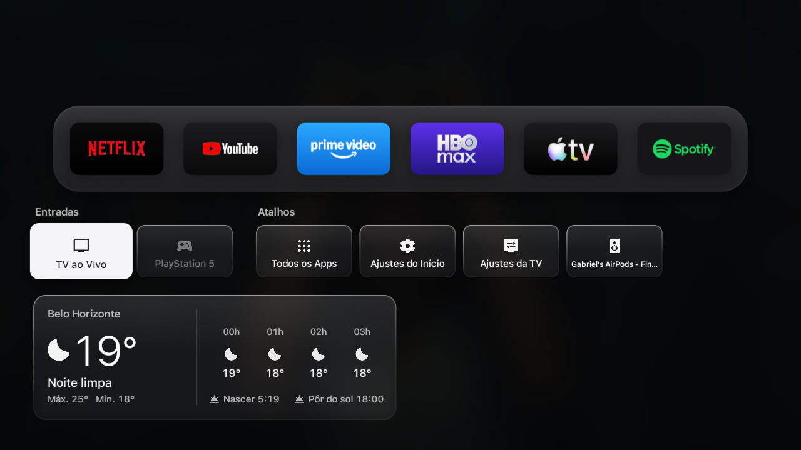

# GB Launcher

[English](README.md) | Português

**Um launcher limpo, ultrarrápido, sem anúncios e no estilo Apple TV para Google TV e Android TV.**


O GB Launcher substitui a tela inicial cheia de anúncios, lentidão e poluição visual da sua Smart TV por uma experiência limpa, fluida e moderna inspirada na Apple TV e no tvOS. Desenvolvido em Java nativo puro sem frameworks pesados, ele roda travado a 60 FPS e protege a sua privacidade.

Palavras-chave: Apple TV Launcher, tvOS Launcher, Google TV Apple Style Launcher, Clean Android TV Launcher, Launcher sem anúncios para TV.

---

## Comparativo: O que muda na sua TV

| O que você ganha | O que você perde | O que para de te rastrear |
| :--- | :--- | :--- |
| Tela inicial limpa e sem anúncios | Vídeos publicitários que tocam sozinhos em tela cheia | Monitoramento constante dos seus hábitos de visualização |
| Navegação suave a 60 FPS no controle | Travamentos, engasgos e lentidão do sistema | Envio contínuo de dados para redes de anúncios |
| Central de Controle lateral rápida | Fileiras poluídas de conteúdo patrocinado | Banners promocionais invasivos |
| Conexão instantânea de áudio Bluetooth | Interface padrão travada e cheia de poluição | Registro de uso de aplicativos em segundo plano |
| Gaveta inferior com entradas HDMI e clima | | |
| Remapeamento de botões do controle remoto | | |
| Restauração segura para a tela original em 1 clique | | |

---

## Capturas de Tela

### Tela Inicial
Layout limpo exibindo seus aplicativos favoritos, abas organizadas e navegação rápida.


### Central de Controle
Painel lateral rápido acessível de qualquer lugar. Conecte ou desconecte dispositivos Bluetooth (fones de ouvido, soundbars, caixas de som), ajuste o volume, alterne perfis de imagem da TV ou troque entre os temas Claro e Escuro sem precisar navegar pelas configurações pesadas da TV.


### Gaveta Inferior (Entradas, Atalhos e Clima)
Pressione para Baixo no controle para abrir as entradas HDMI (com indicador de sinal ativo), atalhos rápidos para TV ao vivo e a previsão do tempo completa com temperatura atual, mínimas/máximas e previsão para as próximas horas.



### Configurações no Estilo iPad e Botões do Controle
Organizadas em cartões agrupados. Personalize a estante de aplicativos, escolha fotos para a tela de descanso e remapeie os botões físicos do controle remoto da sua TV para abrir os aplicativos que você preferir.


---

## Principais Funcionalidades

### 1. Central de Controle
* Áudio Bluetooth: Conecte e desconecte rapidamente fones de ouvido, earbuds, soundbars e caixas de som Bluetooth.
* Volume e Imagem: Slider de volume direto e seleção rápida de modos de imagem da TV.
* Alternância de Tema: Escolha entre Escuro, Claro ou Automático (sincronizado com o nascer e pôr do sol local).

### 2. Gaveta Inferior
* Entradas HDMI: Mostra as portas HDMI da TV (HDMI 1, HDMI 2, etc.) destacando quais estão recebendo sinal ativo no momento.
* Atalhos Rápidos: Acesso direto à TV ao vivo e aos utilitários do sistema.
* Previsão do Tempo: Temperatura em tempo real, condições climáticas, máxima/mínima do dia e previsão hora a hora sem precisar de chave de API.

### 3. Remapeamento dos Botões do Controle Remoto
* Escolha o que cada botão físico do seu controle remoto faz (como botões da Netflix, YouTube, Prime Video ou botões específicos da marca da TV), direcionando para o aplicativo instalado que você desejar.
* Configurável diretamente em Configurações > Botões do Controle.

### 4. Restauração Segura em 1 Clique
* Você pode alternar de volta para a tela inicial de fábrica da TV a qualquer momento com apenas um clique em Configurações > Tela Inicial.
* O GB Launcher não danifica nem altera partições do sistema da sua TV.

---

## Dispositivos Compatíveis

Compatível com TVs e TV boxes equipadas com Android TV ou Google TV (Android 8.0 ou superior / API 26+), incluindo:
* Smart TVs TCL (Google TV)
* Sony Bravia (Google TV e Android TV)
* Chromecast com Google TV (HD e 4K)
* Xiaomi Mi Box e Mi TV Stick
* Philips Android TV
* Onn Google TV Box
* Nvidia Shield TV

---

## Como Instalar

### Opção A: Instalação por Assistente de IA (Mais Fácil)

Se você utiliza um assistente de IA para programação (como Antigravity, Claude Code ou Cursor), certifique-se de que o computador e a TV estejam conectados na mesma rede Wi-Fi e envie o comando abaixo:

```text
Instale o GB Launcher na minha TV no IP <IP_DA_SUA_TV>. Minha TV já está com modo de desenvolvedor e depuração de rede ativados.
```

O assistente cuidará da conexão via ADB, instalação do pacote e orientações na tela.

### Opção B: Instalação Manual via ADB

1. Ative as Opções do Desenvolvedor na sua TV:
   * Acesse Configurações > Sistema > Sobre.
   * Clique em "Número da Versão / Build do SO Android TV" 7 vezes consecutivas até liberar o modo de desenvolvedor.
   * Vá em Configurações > Sistema > Opções do Desenvolvedor e ative "Depuração USB" (ou "Depuração de Rede").
   * Veja o endereço IP da TV em Configurações > Rede e Internet.

2. Conecte e Instale a partir do seu computador:
   ```bash
   adb connect <IP_DA_SUA_TV>:5555
   adb install -r GBLauncher.apk
   ```

3. Inicie o GB Launcher:
   * Abra o GB Launcher na lista de aplicativos da TV.
   * Defina-o como sua tela inicial padrão (você pode voltar para a tela original a qualquer momento).

---

## Compilação a partir do Código-Fonte

O GB Launcher é compilado diretamente pelas ferramentas do Android SDK, sem sobrecarga de Gradle:

```bash
# Definir a variável do Android SDK
export ANDROID_HOME="/caminho/para/android/sdk"

# Compilar, alinhar e assinar o pacote
./build.sh
```

O arquivo `GBLauncher.apk` será gerado diretamente na pasta raiz do projeto.

---

## Créditos e Reconhecimento

O GB Launcher foi construído sobre a base e inspirado no projeto de código aberto [Free My TV](https://github.com/simbasjungles/free-my-tv). O nosso reconhecimento e agradecimento aos autores originais pelo trabalho pioneiro na estrutura de compilação sem Gradle, na renderização fluida para Android TV e na lógica base de integração com o sistema da TV.

---

## Licença

Distribuído sob a licença [MIT](LICENSE).
